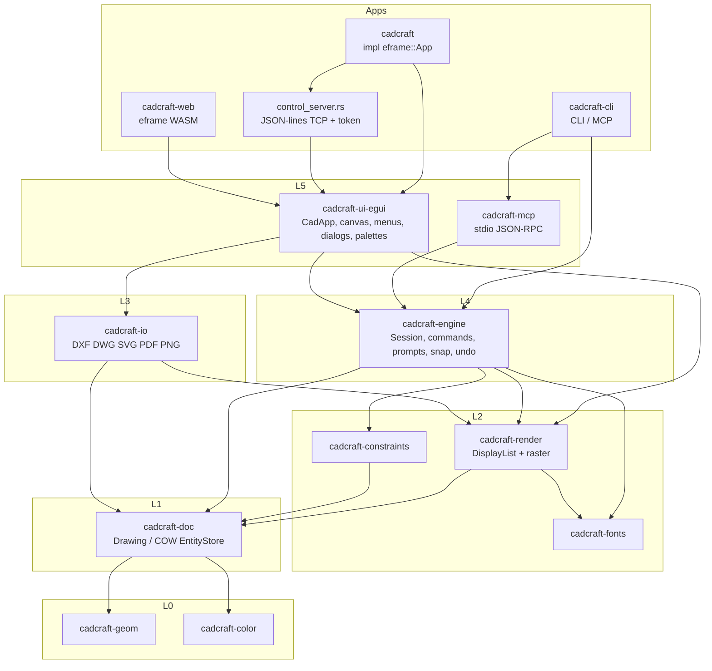
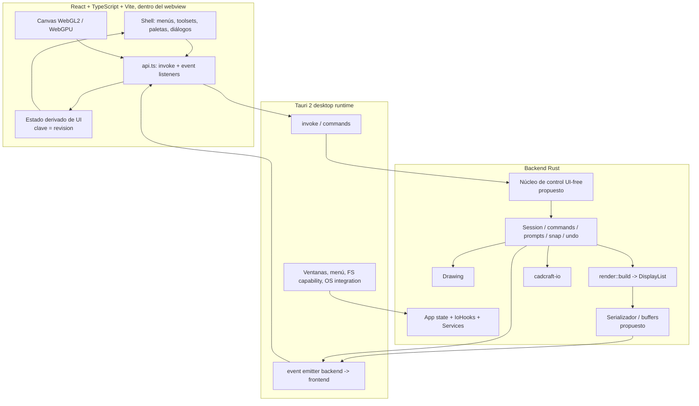
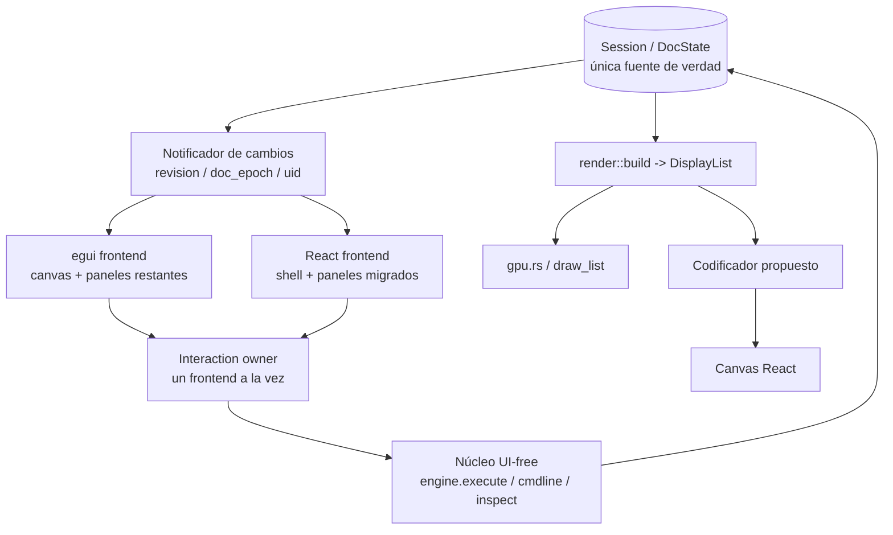
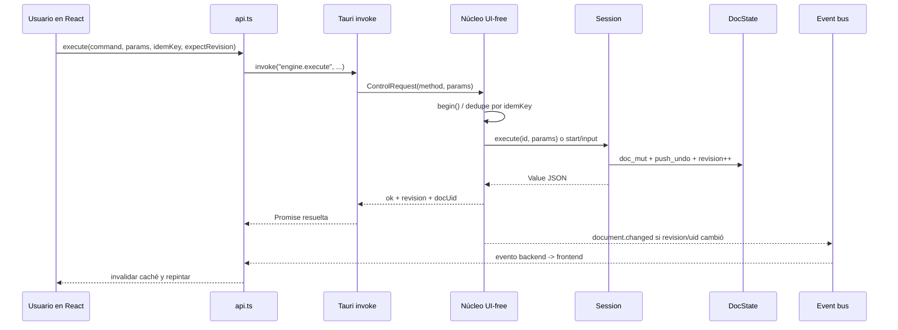
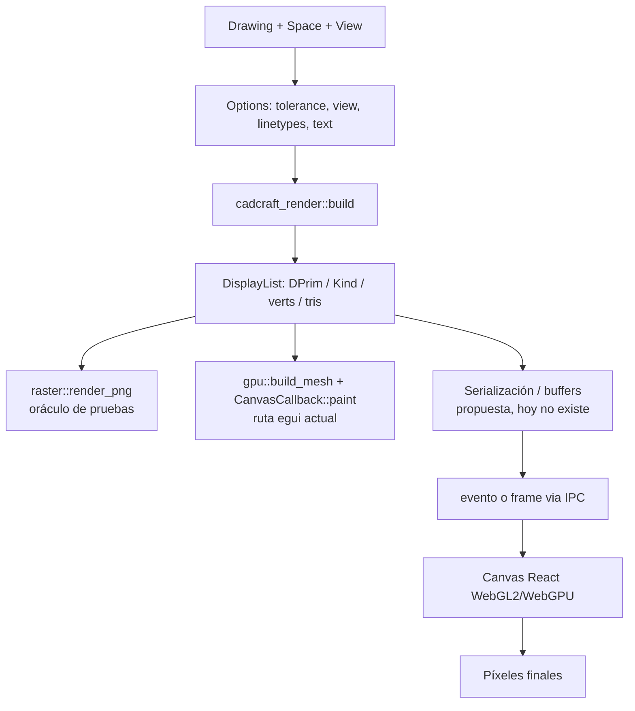

# RFC: Migración progresiva de la GUI de CADCraft a React + TypeScript + Tauri 2

> **Ruta:** `docs/architecture/RFC-react-tauri-migration.md`  
> **Nota de entrega:** el borrador original se entregó en la respuesta de OpenCode porque `docs/architecture/` no existía; el archivo se creó después con autorización explícita del operador.  
> **Fecha:** 2026-11-26.  
> **Estado:** borrador para decisión arquitectónica. No se ha implementado código.

**Metodología y límites de evidencia**

- **[Verificado]** = comprobado directamente con lecturas, `rg`, `sed`, `wc`, `ls`, `git status` sobre el checkout.
- **[Inferido]** = conclusión deducida de la arquitectura verificada; no es una medición.
- **[Propuesto]** = decisión de diseño recomendada por esta RFC; no existe hoy en el código.
- **[Pendiente de validar]** = requiere prototipo, medición o decisión externa.
- No se ejecutaron `cargo test`, `clippy`, `build`, `xtask`, ni se instalaron dependencias. Los recuentos de `#[test]` son estáticos (`rg -o '#\[test\]' ... | wc -l`), no resultados de ejecución.
- Estado observado al redactar: `M mock_absolute_vector.html` (cambio previo del usuario, no tocado) y `?? docs/gui-migration-audit.md` (entregable de una tarea anterior); este último se commitó posteriormente como `c6770ad`.
- `docs/architecture.md` está fechado 2026-10-10 y contiene cifras antiguas (p. ej. “57,000 lines”, “295 engine commands”, “L1 color”). No se usan como métrica actual; se prefiere código y `docs/parity-checklist.md` (generado 2026-11-01) con la advertencia de que tampoco es una medición propia.

---

## A. Resumen ejecutivo

### Problema arquitectónico

CADCraft tiene un motor CAD sustancialmente separado de la interfaz, pero la única interfaz de productividad es `egui/eframe` + `wgpu`. La capa visual ocupa todo el ciclo de frame, el canvas, los menús, las paletas, los diálogos, el docking, los atajos, la accesibilidad y el renderizado GPU. Acercar la experiencia a una aplicación CAD profesional con un stack web moderno exige sustituir esa capa sin tocar el motor.

**[Verificado]** La separación existe y está reforzada por CI: `xtask/src/layers.rs:35-53` sitúa `ui-egui` y `mcp` en L5 y `UI_MIN_LAYER = 5` en `xtask/src/layers.rs:69-74`; ningún crate por debajo de L5 puede depender de `egui`, `eframe`, `egui-wgpu`, `wgpu`, `winit`, `rfd` ni `bevy*`.

**[Verificado]** El workspace tiene 10 crates de biblioteca (`crates/*`), 3 apps (`apps/*`) y `xtask` (`Cargo.toml:1-4`; `ls crates`, `ls apps`).

### Qué se pretende conservar

- `geom`, `color`, `doc`, `constraints`, `fonts`, `render`, `io` y `engine`, tal como están, salvo adaptaciones de interfaz.
- El registro de comandos (`CommandSpec`, `command_specs`), las máquinas interactivas (`Interactive`, `Running`), el snap, la selección, el undo/redo, las unidades, AutoLISP y los codecs de archivo.
- `render::build` → `DisplayList` como fuente de verdad gráfica, y `raster` como oráculo de pruebas.
- El protocolo JSON existente y el MCP como superficies de automatización.

### Qué se pretende reemplazar

- `apps/cadcraft` como shell `eframe::App` (`apps/cadcraft/src/main.rs:103-178`).
- `crates/ui-egui` como toolkit de presentación: `CadApp::draw` (`crates/ui-egui/src/lib.rs:1211-1248`), `canvas.rs`, `menus.rs`, `palettes.rs`, `dialogs.rs`, `docking.rs`, `gpu.rs`, `theme.rs`, `icons.rs`.
- La app web actual basada en el mismo `CadApp` bajo eframe WASM (`apps/cadcraft-web/src/main.rs:1-10`).

### Beneficios esperados

**[Inferido / Propuesto]**

- Un toolkit de UI más expresivo para chrome, paneles y diálogos CAD.
- Mejor accesibilidad y navegación por teclado si se traslada correctamente el contrato AccessKit actual (`crates/ui-egui/src/control.rs:117-198` observa roles/estado; `AGENTS.md:21` exige accesibilidad).
- Un único frontend para desktop y web si se unifica con Tauri + webview.
- Un límite de automatización más tipado reutilizando el canal JSON existente.

Estos beneficios son expectativas, no resultados medidos.

### Principales riesgos

1. **Canvas.** **[Verificado]** La semántica de entrada y la cámara viven en `ui-egui`: `Xf` (`canvas.rs:44-91`), `CanvasState` (`canvas.rs:102-210`), press-first/drag-delay (`canvas/press.rs`) y `gpu.rs:411-498,688-783`. Portar esto es el mayor riesgo.
2. **Sin eventos push.** **[Verificado]** No hay bus de eventos en `engine`; la observación se basa en `DocState::revision`, `Session::doc_epoch` y `is_dirty()` (`doc_state.rs:5-9,84-95`; `lib.rs:98-198`). React necesitará eventos nuevos o sondeo controlado.
3. **`DisplayList` no serializable.** **[Verificado]** `DisplayList`, `DPrim`, `Kind`, `DImage` derivan `Clone/Debug/PartialEq`, pero no `Serialize`/`Deserialize` (`crates/render/src/display.rs:12-118`).
4. **Acoplamiento del centro de control.** **[Verificado]** `control::handle(app, ctx, req)` exige `&mut CadApp` y `&egui::Context` (`crates/ui-egui/src/control.rs:310-317`).
5. **Reglas del repositorio.** **[Verificado]** `AGENTS.md:11` prohíbe escribir JavaScript/TypeScript, Tauri, Electron o webview en las apps. Requiere RFC aprobada en `storytold/craft-contrib` (`AGENTS.md:2`).
6. **Pérdida de comportamiento nativo.** **[Verificado]** Menú nativo macOS, SpaceMouse, ventanas OS, capturas y persistencia de workspace están en `apps/cadcraft` (`main.rs:103-178`, `native_menu.rs`, `spacemouse.rs`, `workspace.rs`).
7. **Fidelidad visual.** **[Verificado]** `docs/ui-parity.md` estima ~48% de fidelidad UI/UX y no fue re-medida; `docs/parity-checklist.md` registra 298/491 ítems de menú (61%) y 449 comandos, generado el 2026-11-01.

### Decisión que debe tomar el equipo

**[Propuesto]** No autorizar una reescritura completa ni la retirada de egui. Autorizar **una fase experimental** que desacople el control de egui, defina contratos y valide el canvas con un prototipo. La migración progresiva queda condicionada a criterios verificables de paridad.

---

## B. Estado arquitectónico actual

### B.1 Workspace y crates

**[Verificado]** `Cargo.toml:1-4` define `members = ["crates/*", "apps/*", "xtask"]`, edition 2024, rust-version 1.95, resolver 3.

| Crate / app | Rol principal | Evidencia |
|---|---|---|
| `cadcraft-geom` | Vectores, curvas, intersecciones, NURBS, regiones | `crates/geom/src/lib.rs:21-36` |
| `cadcraft-color` | ACI, `Rgb`, `Color` | `crates/color/src/lib.rs:9-11,41-80` |
| `cadcraft-doc` | `Drawing`, `Entity`, `Handle`, `EntityStore` COW | `crates/doc/src/lib.rs:101-172`; `crates/doc/src/store.rs:1-27` |
| `cadcraft-constraints` | Solver paramétrico, DOF, expresiones | `crates/constraints/src/lib.rs:39-42,507-525` |
| `cadcraft-fonts` | Stroke/SHX/TTF, MTEXT, BiDi | `crates/fonts/src/lib.rs:37-44,326-459` |
| `cadcraft-render` | `Options`, `build`, `DisplayList`, `raster` | `crates/render/src/lib.rs:1-6`; `pipeline.rs:13-50`; `display.rs:12-118` |
| `cadcraft-io` | DXF/DWG/SVG/SVGZ/PDF/PNG | `crates/io/src/lib.rs:20-27,93-253` |
| `cadcraft-engine` | `Session`, comandos, prompts, snap, selección, undo | `crates/engine/src/lib.rs:98-198`; `cmd.rs:72-90` |
| `cadcraft-ui-egui` | `CadApp`, canvas, menús, diálogos, GPU | `crates/ui-egui/src/lib.rs:290,1211-1248`; `gpu.rs` |
| `cadcraft-mcp` | JSON-RPC sobre stdio, puente al canal de control | `crates/mcp/src/lib.rs:1-8`; `server.rs:45-123` |
| `cadcraft` | `impl eframe::App`, menú nativo, SpaceMouse, control TCP | `apps/cadcraft/src/main.rs:103-178,451-725` |
| `cadcraft-cli` | `info`, `convert`, `run`, `commands`, `mcp` | `apps/cadcraft-cli/src/` |
| `cadcraft-web` | Mismo `CadApp` en WASM; `window.cadcraft` | `apps/cadcraft-web/src/main.rs:1-10`; `api.rs:1-41` |

### B.2 Dependencias entre capas

**[Verificado]** `xtask/src/layers.rs:35-53`:

| Nivel | Crates |
|---|---|
| L0 | `geom`, `color` |
| L1 | `doc` |
| L2 | `constraints`, `fonts`, `render` |
| L3 | `io` |
| L4 | `engine` |
| L5 | `ui-egui`, `mcp` |
| Exempt | `cadcraft`, `cli`, `web`, `xtask` |

**[Verificado]** `crates/engine/Cargo.toml:11-30` declara solo L0-L2, `craft-*`, `serde`, `serde_json`, `thiserror`, `log`, `rstar` y `libc` en Unix. No declara `egui`, `eframe`, `wgpu`, `winit` ni `rfd`.

**[Verificado]** Búsqueda de `\b(egui|eframe|egui_wgpu|wgpu|winit|epaint|rfd)\b` con `rg -l` sobre cada directorio: 0 archivos en `geom`, `color`, `doc`, `fonts`, `render`, `constraints` e `io`; 1 archivo en `engine` (`crates/engine/src/cmd/constraints/tests.rs`, solo comentarios); 159 archivos en `ui-egui`; 14 en `apps/cadcraft`; 4 en `apps/cadcraft-web`.

### B.3 Responsabilidades de cada módulo

| Módulo | Responsabilidad verificada | Símbolos / rutas |
|---|---|---|
| `geom` | Matemática CAD pura | `Vec2`, `Vec3`, `Mat3`, `Bounds2`, `Line`, `Arc`, `Circle`, `Polyline`, `Spline`, `intersect_segments` |
| `color` | Color CAD | `Rgb`, `Color::{ByLayer,ByBlock,Index,True}`, `resolve`, `nearest_aci` |
| `doc` | Base de datos del dibujo | `Drawing`, `Entity { handle, common, kind }`, `Handle(u64)`, `EntityStore`, `Layer`, `Block`, `Layout`, `Prim` |
| `constraints` | Resolución paramétrica | `solve`, `autoconstrain`, `dof`, `Expr` |
| `fonts` | Shapeo de texto | `shape_stroke`, `shape_line`, `TextFont`, `Shaped`, `layout_mtext` |
| `render` | Display list y raster CPU | `Options`, `build`, `build_plot`, `DisplayList`, `DPrim`, `Kind`, `raster::render_png` |
| `io` | Persistencia | `read`, `write`, `write_with`, `SaveOptions`, `plotter::plot` |
| `engine` | Sesión y operaciones CAD | `Session`, `CommandSpec`, `Interactive`, `Prompt`, `SnapHit`, `DocState`, `UndoCtl` |
| `ui-egui` | Interfaz | `CadApp`, `UiState`, `CanvasState`, `Xf`, `menus`, `dialogs`, `palettes`, `gpu::CanvasCallback` |
| `mcp` | Automatización | `Backend`, `Remote`, `serve`, 12 tools base + 3 UI-only |

### B.4 Flujo de ejecución de comandos

**[Verificado]**

1. `CommandSpec` contiene `id`, `label`, `menu`, `shortcut`, `aliases`, `params`, `enabled`, `run`, `undoable`, `interactive`, `transparent` (`crates/engine/src/cmd.rs:72-90`).
2. `command_specs()` registra las familias (`cmd.rs:182-228`). `find_command` y `resolve_alias` resuelven nombre/alias (`cmd.rs:230-245`).
3. Vía JSON: `Session::execute` (`session/execute.rs:11-93`) usa `catch_unwind`, comprueba `enabled`, captura `(doc, selection, uid)` y registra un `Snapshot` si el documento cambia.
4. Vía interactiva: `Session::start` / `start_from` (`session/interactive.rs:85-206`) crea la máquina `Interactive`, guarda `Running { id, machine, before, selection_before }` y alimenta `feed`.
5. Entrada: `input`, `input_snapped`, `feed`, `cancel`, `cmdline`, `script`.
6. Post-proceso: `after_command` ejecuta grupos, restricciones y asociatividad.
7. La GUI entra por `CadApp::run`, `CadApp::start` y `CadApp::cmdline` (`crates/ui-egui/src/lib.rs:610-704`).
8. El canal de control entra por `control::handle` (`control.rs:310-565`) y llama a los mismos puntos.

**[Verificado]** `docs/parity-checklist.md:7` registra 449 comandos y 298/491 ítems de menú; es documento generado, no medición propia de esta RFC.

### B.5 Flujo de interacción del usuario

**[Verificado]**

- `apps/cadcraft/src/main.rs:103-178`: `eframe::App::logic`, `raw_input_hook`, `ui`, `on_exit`, `save`.
- `CadApp::draw` compone título/toolbar, menú, pestañas, toolsets, `CentralPanel`, docking y overlays (`lib.rs:1211-1248`).
- `Xf` convierte mundo↔pantalla y calcula la transformación GPU (`canvas.rs:44-91`).
- `CanvasState` contiene `list`, `gpu`, `mesh_slot`, `drag_slot`, `hl_slot`, `hover`, `snap`, `track`, `press` (`canvas.rs:102-210`).
- `canvas.rs:970-993`: el clic se convierte en `input_snapped(hit)` o `Input::Point(p)`; también `Input::Keyword("Copy")`, grips e `idle_click`.
- `canvas/press.rs`: la semántica press-first y el retardo de drag viven en la GUI, no en el engine.
- `cmdline::capture_tab` (`cmdline.rs:67-85`) intercepta Tab antes del cambio de foco.
- Atajos en `menus.rs:934-1049`; teclado griego en `keyboard.rs` y `session/interactive.rs`.

### B.6 Flujo de renderizado

**[Verificado]**

- `crates/render/src/lib.rs:1-6`: `build` convierte un espacio del drawing en `DisplayList` de polilíneas, triángulos y puntos en coordenadas de mundo.
- `Options` contiene tolerancia, linetypes, texto, view, transparencias, `on_screen`, `skip_viewport` y cancelación (`pipeline.rs:13-50`).
- `DisplayList` contiene `prims`, `verts`, `tris`, `images`, `prim_layers`, `texts`, `bounds`, `sheet`, `expanded`, `truncated`, `pens` (`display.rs:91-118`).
- Límites: `MAX_BLOCK_EXPANSION` y `MAX_DISPLAY_POINTS` en `render/src/lib.rs:139-149`; `truncated` se informa, no se silencia.
- **No implementa serde** (`display.rs:72-118`).
- La GUI dibuja por CPU con `draw_list` (`canvas/draw.rs:86-151`) o por GPU con `draw_list_gpu` y `gpu::CanvasCallback::paint` (`gpu.rs:738-783`).
- El shader WGSL está en `gpu.rs:411-498`; hay validación naga→GLSL ES 3.0 en `gpu.rs:945-961`.
- `raster::render_png` (`raster.rs:377-403`) es la ruta usada por `ui.render` (`control.rs:505-547`) y por pruebas de PNG.

### B.7 Gestión del estado del documento

**[Verificado]**

- `Session` (`engine/src/lib.rs:98-198`) contiene `docs: Vec<DocState>`, `active`, `doc_epoch`, `settings`, `running`, `suspended`, `log`, `cursor`, `ctrl_down`, `viewport_px`, `bars_shown`/`bars_request`, `hatch_picks`, `wblock_picks`.
- `DocState` (`doc_state.rs:19-51`) contiene `doc: Arc<Drawing>`, `saved: Arc<Drawing>`, `undo`, `redo`, `selection`, `revision`, `uid`, `space`, `tiles`, `views`, `block_edit`.
- `doc_mut` usa `Arc::make_mut` (`engine/src/lib.rs:269-275`).
- `EntityStore` usa chunks `Arc<Vec<Arc<Entity>>>` y 64 shards (`doc/src/store.rs:1-27`).
- `is_dirty()` compara identidad de `Arc`, no contenido (`doc_state.rs:84-86`).
- No hay bus de eventos; `revision` y `doc_epoch` son la señal de cambio.

### B.8 Undo/redo

**[Verificado]**

- `Snapshot { label, doc: Arc<Drawing>, selection }` (`doc_state.rs:5-9`).
- `push_undo` en `undoctl.rs:76-112`; `MAX_UNDO = 2000`, `MAX_MARKS = 1000` (`undoctl.rs:8-11`).
- `undo`/`redo` (`session/execute.rs:104-131`) usan `swap_in`, que incrementa `revision` (`doc_state.rs:89-95`).
- Un comando registrado = un paso de undo; `.noundo()` no registra.

### B.9 Sistema de herramientas interactivas

**[Verificado]**

- `Interactive` (`prompt.rs:317-400`) expone `name`, `prompt`, `input`, `begin`, `cancelled`, `preview`, `preview_objects`, `live_value`, `highlight`, `highlight_all`, `drag`, `text_editor`, `display_only`, `attribute_entry`, `array_live`.
- `Prompt` y `Accept` (`prompt.rs:10-64`) son serializables y describen qué entrada se acepta.
- `Running` guarda la máquina en curso; `Session::point_mods`, `tracking`, `cursor_deferred` y `pending_window` completan el estado.
- El snap está en `engine/src/snap.rs` y `snap/tracking.rs`; `snap_cursor` devuelve `CursorSnap` con `point`, `snap`, `track`, `wait` (`snap/tracking.rs:747-841`).
- **[Inferido]** La herramienta interactiva es estado del engine; React solo debe enviar entradas y mostrar prompts.

### B.10 Comunicación frontend/backend existente

**[Verificado]**

- Canal TCP loopback JSON-lines, no HTTP (`apps/cadcraft/src/control_server.rs:1-8`).
- Límites: 16 conexiones, 256 MiB por línea, 512 MiB totales, 64 peticiones en cola, 600 s idle, 30 s escritura, 60 s respuesta (`control_server.rs:20-54`).
- Token de 256 bits por sesión en archivo owner-only (`control_server.rs:58-82`; `crates/mcp/src/control_token.rs`).
- `ControlRequest`/`PendingReply` con estados `QUEUED`, `STARTED`, `CANCELLED` y timeout `not-run` / `may-have-run` (`control.rs:39-109`).
- 27 métodos canónicos en `control.rs:214-242`: `cmdline.input`, `cmdline.script`, `cmdline.key`, `cmdline.state`, `engine.execute`, `engine.commands`, `drawing.inspect`, `ui.inspect`, `ui.elements`, `ui.menu.list`, `ui.menu.invoke`, `ui.pointer`, `ui.click`, `ui.move`, `ui.drag`, `ui.key`, `ui.text`, `ui.set`, `ui.resize`, `ui.focus`, `ui.screenshot`, `ui.render`, `app.open`, `app.save`, `app.quit`, `control.methods`, `ping`.
- `window.cadcraft` ya existe en WASM: `apps/cadcraft-web/src/api.rs:19-41` convierte cada llamada JS en `ControlRequest` y la encola en el mismo `CadApp`. La parte JS pertenece a `craft-web-api`, no a este repo (`api.rs:1-8`): **no verificable aquí** la lista exacta de funciones expuestas.
- `control::handle` requiere `&mut CadApp` + `&egui::Context` (`control.rs:310-317`).

### Componentes dependientes de egui vs independientes

| Clase | Componentes | Evidencia |
|---|---|---|
| Independientes de GUI | `geom`, `color`, `doc`, `constraints`, `fonts`, `render`, `io`, `mcp` y `engine` a nivel de tipos | 0 imports GUI; `xtask/src/layers.rs` |
| Acoplados semánticamente | `Session::cursor`, `ctrl_down`, `viewport_px`, `bars_shown`, `hatch_picks`, `wblock_picks` | `engine/src/lib.rs:141-193` |
| Acoplados al ciclo de frame | `control_server.rs` (`egui::Context`), `apps/cadcraft-web/src/api.rs` | `control_server.rs:58`; `api.rs:24-41` |
| Fuertemente acoplados | `CadApp`, `canvas/*`, `menus.rs`, `dialogs.rs`, `palettes.rs`, `gpu.rs`, `impl eframe::App` | `ui-egui/src/lib.rs`, `apps/cadcraft/src/main.rs:103-178` |

---

## C. Diagramas de arquitectura

### C.1 Arquitectura actual



### C.2 Arquitectura objetivo



### C.3 Arquitectura de coexistencia



**Reglas de coexistencia [Propuesto]:**

- Un solo `Session`/`DocState` por documento abierto; React nunca guarda una copia editable del drawing.
- Un solo `Interaction owner`: el frontend que tiene foco envía `ui.key`/`ui.pointer`; el otro no inyecta entrada.
- Todo cambio pasa por `engine.execute`, `cmdline.input` o un comando registrado.
- La caché de React se invalida por `(docUid, revision)`, nunca por temporizadores.

### C.4 Flujo de ejecución de comandos



### C.5 Flujo de renderizado del Canvas



---

## D. Propuesta de arquitectura objetivo

### Frontend (React + TypeScript + CSS + Vite)

**[Propuesto]** Responsabilidades:

- Chrome: título, toolbar, file tabs, status bar, menús visuales.
- Tool Sets y paletas: capas, propiedades, bloques, quickcalc, paneles dockables.
- Diálogos: formularios y validación de entrada **solo de formato**; la validación de dominio se hace en Rust.
- Inspector: consume `properties.describe` (nuevo método propuesto) y escribe con `properties.set` (comando existente).
- Canvas: captura eventos DOM, traduce a coordenadas de mundo con una transformación equivalente a `Xf`, envía entradas al backend y pinta el `DisplayList`.
- Estado de interfaz: tema, dock layout, foco, diálogos abiertos, paneles visibles. Es estado derivado o preferencia; nunca el documento.
- Componentes reutilizables: botones, campos, tablas, árboles, menús, status items; con tokens de tema y nombres accesibles.

**[Verificado]** Hoy no hay `.ts`, `.tsx`, `.js`, `.jsx`, `package.json`, `vite.config.*` ni `tauri.conf.json` en el repo.

### Desktop runtime (Tauri 2)

**[Propuesto]**

- `invoke` para solicitudes frontend→backend; eventos para backend→frontend.
- Gestión de ventana, menú nativo cuando aplique, diálogos de archivo y capabilities de FS.
- Un adaptador que convierta el envelope JSON propuesto en `ControlRequest`, reutilizando `PendingReply::begin` y la semántica `not-run`/`may-have-run`.
- Mantener el servidor TCP y el MCP intactos para automatización; Tauri es un transporte adicional, no un reemplazo.

### Backend (Rust)

**[Verificado / se mantiene]**

- `Session`, `DocState`, `CommandSpec`, `Interactive`, `Prompt`, `snap`, `select`, `undoctl`, `units`, `lisp`.
- `render::build`, `raster`, `io`, `fonts`, `constraints`.
- `IoHooks` instalados en `apps/cadcraft/src/main.rs:181-195`.

**[Propuesto]**

- Extraer un núcleo UI-free desde `control::handle`: métodos que solo necesitan `&mut Session`, `UiState` y servicios (`engine.*`, `cmdline.*`, `drawing.inspect`, `app.open/save`), separando los que requieren `egui::Context` (`ui.click`, `ui.elements`, `ui.screenshot`).
- Añadir un notificador de cambios basado en `revision`/`doc_epoch`.
- Añadir serialización de `DisplayList` o un codificador a buffers.

### Responsabilidades: Rust vs React

| Responsabilidad | Permanece en Rust | Pasa a React | Comentario |
|---|---|---|---|
| Geometría y tolerancias | ✔ | — | `geom` es GUI-free |
| Documento y handles | ✔ | — | `Drawing`, `Handle`, COW |
| Comandos y alias | ✔ | — | `CommandSpec`, `resolve_alias` |
| Prompts y estado interactivo | ✔ | — | `Interactive`, `Running` |
| Snap, tracking, ortho, polar | ✔ | — | `snap_cursor` |
| Selección y picking | ✔ | Solo presentación del resaltado | `select.rs`, `engine::pick` |
| Undo/redo | ✔ | Botones/historial visual | `undoctl.rs` |
| Unidades y formato numérico | ✔ | — | `units.rs` |
| Display list | ✔ | Consumo/pintado | Sin serde hoy |
| Codecs DXF/DWG/SVG/PDF/PNG | ✔ | — | `io` |
| Solver paramétrico | ✔ | Formularios | `constraints` |
| Menús y atajos visuales | Metadatos | ✔ | `UI_COMMANDS`, `tree` |
| Docking y tema | Preferencias | ✔ | `UiState`, `Tokens` |
| Canvas input semántico | Motor recibe `Input` | Captura DOM y mapeo | No duplicar máquinas de comando |
| Accesibilidad | Contrato de roles | Implementación ARIA | Mantener equivalencia |

**[Inferido]** No hay justificación técnica para mover lógica CAD al frontend: el motor ya expone contratos operativos suficientes mediante JSON y comandos.

---

## E. Contratos API propuestos

### E.1 Evaluación del protocolo existente

**[Verificado]**

- Reutilizable tal cual: `engine.execute`, `cmdline.input`, `cmdline.script`, `cmdline.key`, `cmdline.state`, `engine.commands`, `drawing.inspect`, `ui.inspect`, `ui.menu.list`, `ui.menu.invoke`, `ui.render`, `app.open`, `app.save`, `app.quit`, `control.methods`.
- Reutilizable con abstracción nueva: `ControlRequest`, `PendingReply`, estados `QUEUED/STARTED/CANCELLED`, timeout `not-run`/`may-have-run`.
- No reutilizable directamente: `ui.click`, `ui.move`, `ui.drag`, `ui.elements`, `ui.screenshot` están ligados a `egui::Context` y al frame de egui.
- No existe hoy: creación/cierre de sesión, eventos `document.changed`, API de viewport, API de selección, serialización de `DisplayList`, ids de idempotencia, esquemas tipados.

**[Propuesto]** Mantener los nombres existentes como aliases y añadir un envelope versionado encima para Tauri.

### E.2 Envelope y convenciones comunes

**TypeScript — propuesto**

```ts
export type RequestId = string;
export type SessionId = string;
export type DocUid = string;
export type DocRevision = number;
export type HandleHex = string; // Handle::hex(), doc/src/entity/common.rs:3-18
export type Vec2 = [number, number];

export interface Envelope<P> {
  v: 1;
  id: RequestId;
  method: string;
  params: P;
  sessionId?: SessionId;
  idemKey?: string;          // dedupe de mutaciones
  expectRevision?: DocRevision; // precondition optimista
}

export type ApiError = {
  code:
    | "invalid_params" | "unknown_command" | "disabled" | "stale_revision"
    | "unauthorized" | "busy" | "timeout_not_run" | "timeout_may_have_run"
    | "io_refused" | "internal";
  message: string;
  retryable?: boolean;
};

export type Result<T> =
  | { ok: true; result: T; revision: DocRevision; docUid?: DocUid }
  | { ok: false; error: ApiError };
```

**Rust — propuesto**

```rust
#[derive(Debug, Serialize, Deserialize)]
pub struct Envelope<P> {
    pub v: u32,
    pub id: String,
    pub method: String,
    pub params: P,
    pub session_id: Option<String>,
    pub idem_key: Option<String>,
    pub expect_revision: Option<u64>,
}

#[derive(Debug, Serialize)]
#[serde(tag = "code", rename_all = "snake_case")]
pub enum ApiError {
    InvalidParams { message: String },
    UnknownCommand { message: String },
    Disabled { message: String },
    StaleRevision { message: String },
    Unauthorized { message: String },
    Busy { message: String },
    TimeoutNotRun { message: String },
    TimeoutMayHaveRun { message: String },
    IoRefused { message: String },
    Internal { message: String },
}
```

**[Verificado]** `EngineError::UnknownCommand`, `Disabled` e `Internal` existen como variantes usadas por `Session::execute` (`session/execute.rs:23-39`); los demás códigos son mapeos propuestos del transporte.

### E.3 Categorías de operaciones

Leyenda de estado: **E** = existe; **A** = existe y se adapta; **N** = nuevo propuesto.

#### 1. Session

| Operación | Estado | Dir. | Parámetros | Retorno | Errores | Sync/Async | Modifica doc | Notificación |
|---|---|---|---|---|---|---|---|---|
| `session.create` | N | FE→BE | `{ template?: string }` | `{ sessionId, docUid, revision }` | `invalid_params`, `io_refused` | Async (`invoke`) | No | `session.created` |
| `session.get` | A | FE→BE | `{ sessionId? }` | `SessionSummary` de `Session::summary()` + `revision` | `unauthorized` | Async | No | No |
| `session.close` | N/A | FE→BE | `{ sessionId, force?: bool }` | `{ closed: true }` | `busy`, `unauthorized` | Async | No | `session.closed` |

**[Verificado]** `Session::empty`/`new` y `summary()` existen (`engine/src/lib.rs:383-403`); `app.quit` existe. No existe un método de control `session.create`.

#### 2. Document

| Operación | Estado | Dir. | Parámetros | Retorno | Errores | Sync/Async | Modifica doc | Notificación |
|---|---|---|---|---|---|---|---|---|
| `document.inspect` | A | FE→BE | `{ entities?: bool, limit?: number }` | `DrawingInspection` | `invalid_params` | Async | No | No |
| `document.revision` | N | FE→BE | `{ sessionId? }` | `{ docUid, revision, dirty }` | `unauthorized` | Async | No | No |
| `document.open` | A | FE→BE | `{ path?: string, bytesBase64?: string }` | `{ docUid, revision }` | `io_refused`, `unauthorized` | Async | Sí | `document.changed` |
| `document.save` | A | FE→BE | `{ path?: string, version?, binary? }` | `{ path, revision }` | `io_refused` | Async | No | `document.saved` |
| `document.list` | N | FE→BE | `{}` | `Array<{uid,title,path,dirty}>` | — | Async | No | No |

**[Verificado]** `drawing.inspect` es un comando del engine (`cmd/inquiry.rs:51`); `app.open`/`app.save` existen en el protocolo; `is_dirty()` en `doc_state.rs:84-86`.

#### 3. Commands

| Operación | Estado | Dir. | Parámetros | Retorno | Errores | Sync/Async | Modifica doc | Notificación |
|---|---|---|---|---|---|---|---|---|
| `engine.commands` | A | FE→BE | `{}` | `CommandInfo[]` | — | Async | No | No |
| `engine.execute` | A | FE→BE | `{ command, params, idemKey?, expectRevision? }` | `Value` + envelope | `unknown_command`, `disabled`, `stale_revision`, `internal` | Async | Según comando | `document.changed` si revision cambia |
| `commands.start` | N | FE→BE | `{ command, origin?: "person" }` | `PromptState` | `unknown_command`, `disabled`, `busy` | Async | No | `prompt.changed` |
| `commands.input` | N | FE→BE | `{ input: InputJson, idemKey? }` | `PromptState` | `invalid_params`, `internal` | Async | Puede sí | `document.changed`, `prompt.changed` |
| `commands.cancel` | N | FE→BE | `{}` | `{ cancelled: true }` | — | Async | No | `prompt.changed` |
| `cmdline.state` | A | FE→BE | `{}` | `{ prompt, keywords, accept, historyTail }` | — | Async | No | No |

**[Verificado]** `Session::start`, `input`, `cancel`, `cmdline` existen; `cmdline.state` existe en el protocolo. `Prompt`, `Accept`, `Input` son serializables o interpretables en `prompt.rs:10-64,317-400`.

#### 4. Viewport

| Operación | Estado | Dir. | Parámetros | Retorno | Errores | Sync/Async | Modifica doc | Notificación |
|---|---|---|---|---|---|---|---|---|
| `viewport.get` | N | FE→BE | `{ space? }` | `{ center: Vec2, height: number, twist: number, viewportPx: [number,number] }` | — | Async | No | No |
| `viewport.set` | N | FE→BE | `{ center?, height?, twist?, animate?: false }` | `ViewState` | `invalid_params`, `stale_revision` | Async | No | `viewport.changed` |
| `viewport.zoom` | N | FE→BE | `{ factor?, window?: Bounds2 }` | `ViewState` | `invalid_params` | Async | No | `viewport.changed` |
| `viewport.toWorld` / `toScreen` | N | FE→BE o local | `{ point, rect }` | `Vec2` | `invalid_params` | Sync local recomendado | No | No |

**[Verificado]** `engine::View { center, height, twist }` deriva serde (`engine/src/view.rs:5-14`). `ui.inspect` ya devuelve `view`, `canvasRect` y `cursor` (`control.rs:279-297`). `Xf` es egui-tipado (`canvas.rs:44-91`): su equivalente en React es adaptación propuesta, no reutilización directa.

#### 5. Selection

| Operación | Estado | Dir. | Parámetros | Retorno | Errores | Sync/Async | Modifica doc | Notificación |
|---|---|---|---|---|---|---|---|---|
| `selection.get` | N | FE→BE | `{}` | `{ handles: HandleHex[], previous: HandleHex[] }` | — | Async | No | No |
| `selection.set` | N | FE→BE | `{ handles: HandleHex[], additive?: bool }` | `SelectionState` | `invalid_params` | Async | No | `selection.changed` |
| `selection.clear` | N | FE→BE | `{}` | `{ handles: [] }` | — | Async | No | `selection.changed` |
| `selection.pickAt` | N/A | FE→BE | `{ point: Vec2, aperturePx?: number }` | `{ handle?: HandleHex }` | — | Async | No | No |

**[Verificado]** `DocState::selection` y `Session::set_selection` existen; `engine::select::{pick,pick_all,select_window,select_fence}` existen (`select.rs:415-659`). `ui.pointer` ya permite hacer clic en coordenadas de mundo (`control.rs:393-412`).

#### 6. Rendering

| Operación | Estado | Dir. | Parámetros | Retorno | Errores | Sync/Async | Modifica doc | Notificación |
|---|---|---|---|---|---|---|---|---|
| `render.frame` | A | FE→BE | `{ width, height, window?, background? }` | `{ pngBase64, truncated }` | `invalid_params`, `internal` | Async | No | No |
| `render.displayList` | N | FE→BE | `{ view?, tolerance?, format: "json" | "binary-v1" }` | `DisplayListPayload` | `not_supported_yet` | Async | No | No |
| `render.subscribe` | N | FE→BE | `{ format, view? }` | `{ streamId }` | `busy` | Async | No | `render.frame` eventos |
| `render.unsubscribe` | N | FE→BE | `{ streamId }` | `{ ok: true }` | — | Async | No | No |

**[Verificado]** `ui.render` existe y devuelve `pngBase64` con `truncated` (`control.rs:505-547`). `DisplayList` no tiene serde (`display.rs:72-118`), por lo que `render.displayList` es **bloqueante** hasta que se añada serialización.

#### 7. Properties

| Operación | Estado | Dir. | Parámetros | Retorno | Errores | Sync/Async | Modifica doc | Notificación |
|---|---|---|---|---|---|---|---|---|
| `properties.describe` | N | FE→BE | `{ handles: HandleHex[], filter?: string }` | `Description` | `invalid_params` | Async | No | No |
| `properties.set` | A | FE→BE | Parámetros del comando existente | `Value` | `disabled`, `invalid_params` | Async | Sí | `document.changed` |

**[Verificado]** `cadcraft_engine::properties::describe(d, handles, filter) -> Description` existe y deriva `Serialize` (`properties.rs:1-9,157`); el comando `properties.set` existe (`cmd/props/set.rs:1-26`).

### E.4 Ejemplos JSON

**Solicitud: ejecutar comando con idempotencia y precondition**

```json
{
  "v": 1,
  "id": "req-42",
  "method": "engine.execute",
  "params": {
    "command": "line",
    "params": { "points": [[0, 0], [10, 0]] },
    "idemKey": "toolbar-line-2026-11-26T10:00:00Z-7",
    "expectRevision": 812
  },
  "sessionId": "sess-1"
}
```

**Respuesta correcta**

```json
{
  "ok": true,
  "result": { "message": "LINE" },
  "revision": 813,
  "docUid": "doc-7"
}
```

**Evento backend → frontend**

```json
{
  "v": 1,
  "event": "document.changed",
  "sessionId": "sess-1",
  "docUid": "doc-7",
  "revision": 813,
  "reason": "engine.execute",
  "commandId": "line",
  "originRequestId": "req-42"
}
```

**Comando interactivo**

```json
{
  "v": 1,
  "id": "req-43",
  "method": "commands.start",
  "params": { "command": "circle", "origin": "person" }
}
```

```json
{
  "ok": true,
  "result": {
    "commandId": "circle",
    "prompt": "Specify center point for circle",
    "keywords": [],
    "accept": { "point": true, "number": false, "text": false, "select": false, "enter": true }
  },
  "revision": 813
}
```

**Error de revision obsoleta**

```json
{
  "ok": false,
  "error": {
    "code": "stale_revision",
    "message": "Expected revision 812, current is 813",
    "retryable": false
  },
  "revision": 813
}
```

**Timeout seguro, reutilizando semántica existente**

```json
{
  "ok": false,
  "error": {
    "code": "timeout_not_run",
    "message": "Request timed out before the app started it",
    "retryable": true
  }
}
```

### E.5 Consistencia, errores y duplicación

**[Propuesto]**

- **Fuente única:** `Session`/`DocState` en Rust. React conserva solo una caché clave por `(docUid, revision)`.
- **Idempotencia:** `idemKey` se registra en el núcleo UI-free; si una petición con la misma clave ya fue `STARTED` o respondida, se devuelve la respuesta cacheada. Esto complementa `ControlRequest::begin()` (`control.rs:58-63`), que evita ejecutar peticiones canceladas.
- **Precondition:** `expectRevision` produce `stale_revision`; el frontend vuelve a leer estado antes de reintentar.
- **Timeouts:** conservar `not-run` (reintente seguro) y `may-have-run` (no reintente sin inspeccionar).
- **Comandos largos:** el estado vive en `Running`; React solo envía `commands.input` y muestra `PromptState`. No crear una máquina de estados de comando en TS.
- **Notificaciones:** eventos `document.changed`, `prompt.changed`, `selection.changed`, `viewport.changed`, `render.frame`. No polling, salvo reconexión.
- **Versionado:** campo `v`; `control.methods` sigue siendo la lista canónica y se propone un equivalente `api.methods` con esquemas.
- **Errores:** el backend nunca interpreta mensajes de texto para decidir; usa `code`. El texto es para mostrar, traducido en frontend con claves inglesas (`AGENTS.md:16`).

---

## F. Estrategia de renderizado del Canvas

### Alternativa 1 — WGPU nativo reutilizando el pipeline actual

**Evidencia [Verificado]**

- `gpu.rs:411-498` contiene el shader WGSL.
- `gpu.rs:688-698` `install(rs: &egui_wgpu::RenderState, ...)`.
- `gpu.rs:700-783` implementa `egui_wgpu::CallbackTrait` con `prepare` y `paint`.
- `gpu.rs:945-961` valida WGSL y su traducción GLSL ES 3.0 con naga.
- `CanvasState::gpu: Option<GpuTarget>` y fallback CPU en `canvas.rs:453-457`.

**Ventajas [Inferido]**

- Máxima paridad con el render actual; no reescribir linetypes, hatches ni texto.
- El shader ya está validado para WebGL2.

**Desventajas / riesgos [Pendiente de validar]**

- `CanvasCallback` está acoplado a `egui_wgpu::CallbackTrait` y al `RenderState` de eframe.
- No hay evidencia en el repo de composición de una surface wgpu nativa con el webview de Tauri 2.
- Stencil para viewports recortados y sincronización de frames serían trabajo nuevo.
- Dos superficies (webview + wgpu) podrían duplicar coste y complicar foco/transparencia.

**Complexity:** media-alta. **Compatibility:** nativo, plataforma-específica. **Performance esperado:** hipótesis de bajo overhead si se comparte device; sin medición. **Viabilidad a largo plazo:** incierta sin prototipo.

### Alternativa 2 — Renderizador WebGPU/WebGL desde `DisplayList`

**Evidencia [Verificado]**

- `DisplayList` ya contiene primitivas simples: `Polyline`, `Tris`, `Mask`, `Point`, `Infinite`, `Image` (`display.rs:12-28`).
- `raster::render_png` puede servir de oráculo (`raster.rs:377-403`).
- `DisplayList` **no** deriva serde (`display.rs:72-118`).

**Ventajas [Inferido]**

- Encaja con Tauri/React y con el stack web existente.
- WebGL2 está disponible en la app web actual como fallback (`apps/cadcraft-web/src/main.rs:4,159-163,217-223`).
- Permite mantener `render::build` como fuente de verdad.

**Desventajas / riesgos**

- Requiere nuevo formato de serialización o buffers generados en Rust: **cambio de código**, no solo adaptación.
- Transferencia de `verts`/`tris` para dibujos grandes; `MAX_DISPLAY_POINTS` llega a 64 M (`render/src/lib.rs:149`).
- Texto stroke/SHX/TTF, hatches, transparencias, antialiasing y viewports necesitan paridad.
- Picking preciso debe seguir en el engine; el canvas web no debe convertirse en motor.

**Complexity:** media-alta. **Compatibility:** alta en WebGL2; WebGPU dependiente de plataforma. **Performance esperado:** hipótesis; la serialización puede dominar. **Viabilidad a largo plazo:** alta si se mantiene el contrato de primitivas.

### Alternativa 3 — Rasterización en Rust y transmisión de imágenes

**Evidencia [Verificado]**

- `ui.render` ya devuelve `pngBase64` (`control.rs:505-547`).
- `raster::render` y `render_png` usan tiny-skia (`raster.rs:79,377-403`).

**Ventajas [Inferido]**

- Paridad de píxeles inmediata para vistas estáticas.
- Implementación corta: reutilizar `ui.render`.

**Desventajas**

- Latencia por encode/decode y transferencia de imagen completa en cada pan/zoom.
- Escalabilidad dudosa para interacción continua.
- Pierde selección por handle, grips e overlays vectoriales si se usa solo PNG.

**Complexity:** baja. **Compatibility:** alta. **Performance esperado:** hipótesis de baja para interacción, aceptable para thumbnails/export. **Viabilidad a largo plazo:** baja como canvas principal; alta como modo de accesibilidad o golden.

### Alternativa 4 — WASM

**Evidencia [Verificado]**

- `apps/cadcraft-web` ejecuta el mismo `CadApp` mediante eframe WASM (`main.rs:1-10`).
- `render` desactiva rayon en wasm (`render/Cargo.toml:20-22`; `pipeline.rs:1-5`).
- El web no tiene filesystem (`no_file_system: true`, `main.rs:107-113`).
- Fuentes: `fonts/build.rs:1-9` incrusta un subconjunto en wasm.
- `window.cadcraft` usa la misma cola de control (`api.rs:19-41`).

**Ventajas [Inferido]**

- Reutilización máxima del motor en navegador.
- Base ya existente para un frontend web.

**Desventajas**

- Para desktop con Tauri añadiría una segunda estrategia de ejecución.
- Hilos, SharedArrayBuffer, fuentes y persistencia requieren validación.
- No resuelve por sí sola el renderizado en el webview de Tauri.

**Complexity:** media. **Compatibility:** alta en web, no necesaria en desktop. **Performance esperado:** hipótesis; sin medición propia. **Viabilidad a largo plazo:** alta para una SKU web unificada; media como puente del desktop.

### Recomendación [Propuesto]

- **Vía principal:** Alternativa 2, con `render::build` y `DisplayList` como fuente de verdad y WebGL2 primero, WebGPU después si la plataforma lo permite.
- **Prototipo de riesgo paralelo:** Alternativa 1 limitada a extraer el shader WGSL y medir su integración en una superficie Tauri; si resulta inviable en la práctica, se descarta sin afectar al motor.
- **No usar** Alternativa 3 como canvas interactivo; conservarla para golden y exportación.
- **Evaluar** Alternativa 4 solo si se decide una sola app web para desktop y navegador.

**Prototipo mínimo para validar:** ver § “Primer experimento recomendado”.

---

## G. Plan de coexistencia egui + React

### Principios de coexistencia [Propuesto]

1. **Una sola sesión:** un `Session` por proceso; no se crea una sesión paralela para React.
2. **Una sola fuente de verdad:** `DocState` en Rust; React guarda solo `docUid` + `revision` y datos derivados.
3. **Un solo dueño de la interacción:** el frontend con foco reclama `Interaction owner`; el otro deja de inyectar entrada.
4. **Un solo despacho de comandos:** ambos frontends pasan por el mismo núcleo UI-free.
5. **Un solo historial de undo:** `DocState::undo`; ningún frontend implementa undo propio.
6. **Un solo viewport persistente:** `engine::View` más el rect del canvas activo.
7. **Eventos, no sondeo:** React se actualiza por eventos con `revision` como cursor.

### Fases

| Fase | Componentes | Cambios requeridos | Dependencias | Riesgos | Criterios de aceptación | Condición para avanzar |
|---|---|---|---|---|---|---|
| **0. egui principal** | `apps/cadcraft`, `ui-egui` | Ninguno; congelar baseline | — | Regresiones no detectadas | Baseline de comandos, golden de documentos y PNG registrado | RFC aprobada y baseline guardado |
| **1. API UI-free** | `control.rs`, `control_server.rs`, MCP | Dividir `handle` en núcleo `Session+UiState` y adaptadores egui; añadir eventos y envelope | Cargo/Rust; tests API | Romper protocolo actual | Los 27 métodos siguen respondiendo igual; nuevos métodos cubiertos por tests; TCP y MCP sin cambios funcionales | Paridad de API demostrada |
| **2. React como shell** | React shell + Tauri IPC + egui canvas | Menús, toolsets, paletas no-canvas en React; egui conserva el canvas | Fase 1; Tauri prototipo | Dos toolkits en una ventana; foco | Abrir drawing, ejecutar comandos y ver estado desde React sin copiar documento | Foco y eventos estables; sin doble ejecución |
| **3. Paneles y herramientas** | Inspector, capas, diálogos | Migrar por familias; convertir escritos directos a comandos | Fase 2 | `dialogs.rs:51-62` escribe `session.settings` directamente | Cada panel migrado pasa replay de interacción; mismo undo | 100% de replay de la familia |
| **4. Canvas** | Canvas React + serialización | `DisplayList` → WebGL2/WebGPU; portar `Xf`/`Press` como lógica pura | Fase 1 + prototipo §F | Paridad visual, rendimiento, grips, snap | Golden PNG y replay de eventos equivalentes; umbrales propuestos en §K | Paridad verificable y reversible |
| **5. Retirada de egui** | Apps, features flags | Eliminar `eframe`, `ui-egui`, servidor TCP si se decide | Fases 0-4 | Pérdida de nativo/HID/accesibilidad | CLI/MCP siguen funcionando; GUI cumple criterios | Aprobación explícita; ninguna función sin equivalente |

**[Verificado]** `dialogs.rs:51-62` lee `drafting_settings()` y escribe `&mut app.session.settings` desde el widget; antes de migrar esa paleta debe convertirse en comando registrado para cumplir `AGENTS.md:14`.

---

## H. Migración de componentes visuales

| Componente | Clasificación verificada | Evidencia | Debe pasar a React | Debe permanecer en Rust |
|---|---|---|---|---|
| Menús | **Acoplado al motor** | `menus.rs:79-142` `UI_COMMANDS`; `tree:700`, `activate:847` | Render, atajos visuales, menú contextual | `UI_COMMANDS`, `tree`, `find_command`, `activate` |
| Toolbar / Tool Sets | **Interacción** | `chrome.rs`, `palettes.rs`, `blocks_palette.rs`; llaman `app.run/start` | Botones, agrupación, estado visual | Comandos y `enabled` |
| Paletas | **Acoplado** | `engine::properties::{Description,Group,Row}`; `palettes/described.rs:31` | Widgets, layout, edición controlada | Descripción de filas, `properties.set` |
| Inspector | **Acoplado** | `properties.rs:1-9,157`; `cmd/props/set.rs` | Presentación y formularios | `describe`, `set`, validación |
| Diálogos | **Acoplado** | `dialogs.rs:11-47`; `dsettings` escribe settings | Formularios y navegación | Comandos; quitar escritos directos |
| Docking | **Puramente visual + persistencia** | `docking.rs:79-414`; `craft_ui::docking`; `UiState` | Layout y paneles | `Workspace` persistido |
| Status bar | **Interacción ligera** | `chrome.rs:332-380`; lee session/perf | Texto y formatos | `Session::summary`, datos de perf |
| ViewCube | **Interacción** | `viewcube.rs`, usa `Xf`/`View` | Pintado y gestos | `engine::View`, `twist` |
| Canvas | **Acoplado al motor** | `canvas.rs:44-210,852-1289`; `canvas/*` | Eventos DOM y pintado de primitivas | `Input`, snap, grips, selección, cámara semántica |
| Grips | **Acoplado** | `engine::grips.rs`, `canvas/grips.rs` | Overlay y gestos | Cálculo de grips y comandos |
| Snap | **Acoplado** | `snap.rs`, `snap/tracking.rs:747-841` | Marcador visual, cursor | `snap_cursor`, `CursorSnap`, tracking |
| Dynamic Input | **Acoplado** | `dyninput.rs`, `Interactive::live_value` (`prompt.rs:340`) | Cajas y presentación | Cálculo del valor y prompt |
| Tracking | **Acoplado** | `snap/tracking.rs` | Líneas guía visuales | `Tracker`, adquisición, DWELL |
| Selección | **Acoplado** | `select.rs:415-659`, `Session::set_selection` | Resaltado y picks | Picking, ventanas, fence, cycling |
| Navegación | **Interacción** | `canvas/viewport.rs`, `engine::View` | Zoom/pan gestures | Estado de vista y límites |
| Temas e iconos | **Puramente visual** | `theme.rs`, `icons.rs`; `Tokens` | CSS/tokens e iconos SVG/canvas | Valores compartidos si se versionan |
| i18n | **Presentación con regla** | `i18n.rs`; `AGENTS.md:16` | Catálogos y claves | Claves inglesas estables |
| Capturas/screenshots | **Acoplado al frame** | `capture.rs`, `ui.screenshot` | Solicitud y visualización | Captura real y arbitraje de identidad |

---

## I. Seguridad y estabilidad

### IPC

**[Verificado]** El canal actual usa loopback TCP, token owner-only, comparación en tiempo constante y límites duros (`control_server.rs:20-82`; `control_token.rs`). HTTP está rechazado explícitamente (`control_server.rs:251-253,329-334`).

**[Propuesto]** En Tauri:

- El webview es un límite de confianza: todo `params` se valida en Rust.
- Usar capabilities mínimas: solo FS de los directorios autorizados; ningún shell arbitrario.
- Mantener el token TCP para MCP; no reutilizar el token como secreto Tauri.
- Registrar un `origin` de la petición y exigir `Interaction owner` para entradas de teclado/ratón.

### Validación de entradas

**[Verificado]** `finite.rs` rechaza coordenadas no finitas; `file_access.rs` confina rutas; `io` y `render` tienen límites de tamaño; `catch_unwind` protege comandos e inputs (`session/execute.rs:11-39`; `session/interactive.rs:405-479`).

**[Propuesto]** El backend debe rechazar antes de ejecutar: parámetros desconocidos, tipos incorrectos, revision obsoleta, id duplicado con payload distinto y tamaños fuera de límite.

### Límites de confianza

- React: no confiable para integridad del documento; puede enviar intenciones.
- Rust: autoridad exclusiva para estado CAD, IO y undo.
- Tauri: transporte y capabilities; no lógica de negocio.

### Acceso a archivos

**[Verificado]** `IoHooks` se instalan en `apps/cadcraft/src/main.rs:181-195`; `file_access.rs` implementa raíces de automatización; `mcp` las usa en modo headless.

**[Pendiente de validar / No conforme]** `AGENTS.md:18` exige que `mcp` rechace arrancar sin `--automation-read-root` y `--automation-write-root`. El código las define como `Option<String>` (`apps/cadcraft-cli/src/args.rs:279-285`) y `McpTarget::Headless` las acepta opcionales (`args.rs:535-540`). Esta divergencia debe resolverse por separado, sin cambiar la regla.

### Sesiones y recuperación

- **[Verificado]** `doc_epoch` invalida screenshots tras cambio de dibujo (`engine/src/lib.rs:101-104`).
- **[Verificado]** Autosave/recovery en desktop; ausente en web (`docs/gaps.md` fila 5).
- **[Propuesto]** Un evento `session.created/closed`; un `sessionId` en cada petición; limpieza de `idemKey` cache al cerrar sesión.

### Integridad del documento

- **[Propuesto]** `expectRevision` en mutaciones; `document.changed` con `revision` posterior.
- **[Verificado]** COW y snapshots completos (`doc_state.rs:5-95`; `store.rs:1-27`) hacen barato el rollback; `catch_unwind` restaura doc/selección ante pánico.
- **[Propuesto]** Nunca aplicar en React un parche directo al drawing; solo re-renderizar desde el estado devuelto por el backend.

### Rendimiento con documentos grandes

**[Verificado]** Existen `MAX_BLOCK_EXPANSION`, `MAX_DISPLAY_POINTS`, `truncated`, cancelación de rebuild (`pipeline.rs:13-50`), rebuild en segundo plano (`canvas/rebuild.rs:86-103`) e índice R-tree (`engine/src/spatial.rs`).

**[Pendiente de validar]** Coste de serializar `DisplayList`, transferencia IPC y frame time del canvas web. No hay medición propia en esta RFC.

---

## J. Compatibilidad con las reglas del repositorio

| Regla | Efecto sobre la migración |
|---|---|
| `AGENTS.md:9` | Parsers/codecs/protocolos/widgets reutilizables deben vivir en `storytold/craft-libs`; el adaptador IPC debe evaluarse allí antes que duplicarse en la app. |
| `AGENTS.md:10` | Nuevas dependencias git deben venir de storytold y a un `rev` único; Tauri no está hoy en `Cargo.toml`. |
| `AGENTS.md:11` | **Bloqueo directo:** “Apps SHOULD be Rust only: no handwritten JavaScript or TypeScript, Tauri, Electron or webview.” Requiere RFC aprobada en craft-contrib antes de escribir código. |
| `AGENTS.md:14` | Paneles solo mutan estado por comandos registrados; `dialogs.rs:51-62` ya es una excepción a corregir. |
| `AGENTS.md:16` | Texto de usuario pasa por i18n con inglés como clave; React debe usar las mismas claves. |
| `AGENTS.md:18` | `mcp` debe rechazar arrancar sin roots; implementación actual diverge; resolver antes de ampliar automatización. |
| `AGENTS.md:21` | Accesibilidad: roles, nombres, foco, live region, contraste; migrar implica reproducir/mejorar el contrato, no perderlo. |
| `AGENTS.md:22` y `docs/feature-names.md` | No usar “Vectorworks” como nombre de feature; solo como referencia de comportamiento/compatibilidad. |
| `AGENTS.md:23-24` | Clean room: no copiar código, activos ni redacción de terceros; el mock declarado “Design study only” solo puede inspirar comportamiento propio. |
| `AGENTS.md:25-26` | Fuentes en craft-fonts; toda dependencia nueva (React, Tauri, Vite, TS) debe tener licencia aprobada en `standards/licences.md` antes de incluirse. |
| `xtask/src/layers.rs:69-74` | Nuevo backend debe permanecer por debajo de L5 en dependencias GUI; un crate Tauri sería L5/app, no L4. |
| `## This repository` en `AGENTS.md` | Checks aplicables: `cargo test`, `clippy`, `xtask layers/assets/wasm/parity`; progreso en `ROADMAP.md` con fragmento por cambio. |

**Decisiones que requieren aprobación explícita [Propuesto]:**

1. RFC en `storytold/craft-contrib` que modifique la regla “Rust only”.
2. Aprobación de licencias de React, TypeScript, Vite, Tauri y dependencias transitivas.
3. Creación de un crate/app Tauri y de un adaptador IPC (posiblemente en craft-libs).
4. Nuevos formatos de serialización de `DisplayList`.
5. Cualquier retirada de `ui-egui`, `eframe`, servidor TCP o `apps/cadcraft-web`.
6. Cambios en el contrato MCP o en las raíces de automatización.

No se modificó ninguna regla en esta RFC.

---

## K. Plan de validación y regresión

### Estado actual de tests [Verificado, no ejecutados]

Recuento estático de `#[test]`:

| Crate / app | `#[test]` |
|---|---:|
| `engine` | 2161 |
| `io` | 1117 |
| `ui-egui` | 760 |
| `render` | 237 |
| `fonts` | 155 |
| `doc` | 136 |
| `geom` | 120 |
| `constraints` | 54 |
| `mcp` | 40 |
| `apps/cadcraft` | 129 |
| `apps/cadcraft-cli` | 88 |
| `apps/cadcraft-web` | 7 |
| `xtask` | 33 |

**[Verificado]** Existen binarios `tests/it/main.rs` en `engine`, `io`, `doc`, `render`, `ui-egui`, `mcp` y `cadcraft-cli`.  
**[Verificado]** `crates/ui-egui/tests/it/control_methods.rs:23-60` comprueba que la documentación y los métodos del protocolo coinciden.  
**[No verificado]** Resultados de ejecución, cobertura y rendimiento: no se ejecutaron pruebas.

### Pruebas a mantener y añadir

| Área | Prueba | Qué demuestra |
|---|---|---|
| Engine | `cargo test -p cadcraft-engine` | Comandos, prompts, undo, snap, LISP, hostile input |
| Comandos | Golden de `engine.commands` | id, label, menú, alias, `enabled`, `params` sin cambios |
| Undo/redo | Replay de secuencias por JSON e interactivo | Mismo número de pasos y mismo `Drawing` final |
| IO | Roundtrip de corpus externo `CADCRAFT_CORPUS_DIR` | Persistencia sin regresión |
| Documento | Golden de `Drawing`/handles + `raster::render_png` | Estado y vista reconstructibles |
| Render | Comparación PNG egui-GPU vs nuevo canvas | Paridad de linetypes, hatches, texto, imágenes, viewports, transparencias |
| Interacción | Replay de `ui.pointer`/`ui.key`/`cmdline.input` | Misma secuencia de prompts y revisión final |
| Contratos | Test de todos los métodos `api.methods` | Esquemas, errores, idempotencia, `stale_revision` |
| Tauri | Integración invoke/event en win/mac/linux | IPC, foco, FS capability, cierre |
| Rendimiento | Benchmark de `build` + serialización + frame | Coste real frente al baseline |

### Métricas y umbrales iniciales propuestos

**[Propuesto; pendiente de validar]**

| Métrica | Objetivo inicial | Estado |
|---|---|---|
| Comandos expuestos en React | 100% de `engine.commands` con id estable | Objetivo, no medido |
| Métodos API con test de contrato | 100% | Objetivo, no medido |
| Replay de interacciones críticas | 100% de secuencias gold sin divergencia de `revision` | Objetivo, no medido |
| Undo/redo | Misma profundidad y mismo estado final | Objetivo, no medido |
| Golden PNG, vistas estáticas | Diferencia ≤ 0,1% de píxeles sobre umbral ΔE acordado | Objetivo, no medido |
| Latencia de mutación | p95 ≤ 50 ms desde `invoke` hasta evento `document.changed` en drawing de 10k entidades | Objetivo, no medido |
| Frame time del canvas | p95 ≤ 16,7 ms en escenario de referencia | Objetivo, no medido |
| Transferencia de display list | ≤ 8 MiB por frame en escenario de referencia, con `truncated` visible | Objetivo, no medido |
| Doble ejecución | 0 comandos duplicados bajo timeout/retry | Objetivo, no medido |

---

## L. Riesgos y decisiones pendientes

| Riesgo | Probabilidad | Impacto | Mitigación | Evidencia |
|---|---|---|---|---|
| Regla “Rust only” bloquea la migración | Alta | Alta | RFC en craft-contrib antes de código; no tocar `AGENTS.md` local | `AGENTS.md:11`, `:2` |
| Paridad insuficiente del canvas web | Alta | Alta | Prototipo §F; golden PNG; mantener egui hasta equivalencia | `canvas/*`, `gpu.rs`, `raster.rs` |
| Duplicación de estado documento | Media | Alta | `Session` única; caché por `(docUid, revision)`; `Interaction owner` | `doc_state.rs`, `Session` |
| `DisplayList` sin serde | Alta | Media | Codificador en Rust; `ui.render` como fallback; medir coste | `display.rs:72-118` |
| Sin eventos push en engine | Alta | Media | Notificador basado en `revision`/`doc_epoch`; sin polling | `doc_state.rs:84-95` |
| Acoplamiento `control::handle` a egui | Alta | Media | Extraer núcleo UI-free en Fase 1; conservar aliases | `control.rs:310-317` |
| Pérdida de menú nativo/HID/ventanas OS | Media | Alta | Inventario de `apps/cadcraft`; probar por plataforma antes de Fase 5 | `main.rs:103-178`, `native_menu.rs`, `spacemouse.rs` |
| Fuentes y texto CAD | Media | Alta | Usar `fonts` en Rust; no reimplementar shapeo en TS | `fonts/src/lib.rs`, `build.rs` |
| Rendimiento con dibujos grandes | Media | Alta | Respetar límites y `truncated`; benchmark antes de decidir | `render/src/lib.rs:139-149` |
| Seguridad IPC/webview | Media | Alta | Capabilities mínimas, validación en Rust, no shell arbitrario | `control_server.rs`, `file_access.rs` |
| Accesibilidad regresiva | Media | Alta | Mapear roles/estado actuales; pruebas de equivalencia | `control.rs:117-198`, `AGENTS.md:21` |
| Uso indebido de marca de referencia | Baja | Alta | Solo especificación de comportamiento; nombre de feature propio | `AGENTS.md:22-23`, `docs/feature-names.md` |
| Divergencia MCP roots | Verificada | Media | Resolver en PR separado antes de ampliar automatización | `AGENTS.md:18` vs `args.rs:279-285,535-540` |

### Decisiones que no pueden tomarse sin experimentación

1. Si una surface wgpu nativa puede compartir/componerse con el webview de Tauri 2 en las tres plataformas.
2. Si WebGL2 alcanza paridad visual suficiente para linetypes, hatches, TTF/SHX y viewports.
3. Si WebGPU en webview está disponible de forma consistente o debe ser solo aceleración opcional.
4. Coste real de serializar/transferir `DisplayList`.
5. Si el canvas necesita un stream binario o basta JSON para el prototipo.
6. Si se mantiene una sola app Tauri o se conserva además `cadcraft-web`.
7. Si se soportan múltiples sesiones/documentos activos con `sessionId`, o una sola sesión por ventana.
8. Cómo mapear el árbol AccessKit actual a ARIA sin pérdida de roles/nombres/estados.
9. Umbrales definitivos de rendimiento y paridad de píxeles.

### Decisiones arquitectónicas que requieren aprobación

- Aprobar el cambio de norma “Rust only”.
- Aprobar dependencias y licencias nuevas.
- Aprobar el contrato API versionado y su eventual publicación en craft-libs.
- Aprobar la estrategia de renderizado resultante del prototipo.
- Aprobar cada fase antes de avanzar, especialmente la retirada de egui.

---

## M. Roadmap

| # | Etapa | Entregable verificable | Criterio de finalización | Dependencias |
|---:|---|---|---|---|
| 1 | Baseline y pruebas | Golden de comandos, documentos y PNG; inventario de gaps | Suite actual ejecutada y resultados registrados en un PR de baseline | Ninguna |
| 2 | RFC y aprobación | Esta RFC + RFC de craft-contrib si aplica | Decisión registrada; licencias revisadas | Etapa 1 |
| 3 | Desacoplamiento del control | Núcleo UI-free + adaptador egui + adapters TCP/MCP/web | Los 27 métodos existentes siguen igual; tests de paridad de API | Etapa 2 |
| 4 | Contratos API | `api.methods`, esquemas TS/Rust, eventos, idempotencia | Tests de contrato, timeout y `stale_revision` | Etapa 3 |
| 5 | Prototipo React/Tauri | Shell mínimo que abre un drawing y ejecuta comandos | Sin copia del documento; evento `document.changed` correcto | Etapas 3-4 |
| 6 | Shell de interfaz | Menús, toolsets, paletas no-canvas en React | Replay de interacción de chrome; foco sin doble entrada | Etapa 5 |
| 7 | Integración del Canvas | Renderizador propuesto + `DisplayList` serializado | Golden PNG y métricas propuestas alcanzadas | Etapas 4-6 |
| 8 | Migración de componentes | Paneles y diálogos por familias | Cada familia con replay equivalente; escritos directos convertidos en comandos | Etapas 6-7 |
| 9 | Validación de paridad | Informe de paridad funcional, visual, accesibilidad y rendimiento | Criterios de §K cumplidos o excepciones aprobadas | Etapa 8 |
| 10 | Retirada de egui | Eliminación de `ui-egui`, `eframe`, transporte antiguo si aplica | CLI/MCP y GUI sin funciones sin equivalente; aprobación explícita | Etapa 9 |

**[Propuesto]** Cada etapa debe ser reversible: los adapters antiguos se conservan hasta que la nueva ruta pase las pruebas. No se asignan fechas.

---

## Decisión solicitada

- [ ] Aprobar la migración progresiva.
- [x] **Aprobar únicamente una fase experimental.** _Recomendado: etapas 1-5 de la §M; sin tocar el motor ni retirar egui._
- [ ] Solicitar cambios a la RFC.
- [ ] Rechazar la propuesta.

## Primer experimento recomendado

**Objetivo:** reducir el riesgo del canvas sin comprometer la app actual.

**Experimento mínimo [Propuesto]:**

1. Crear, fuera del árbol de producto y como prototipo desechable, un binario Rust que:
   - abra un drawing de prueba,
   - construya un `DisplayList` con `cadcraft_render::build`,
   - lo codifique a un formato simple (JSON para polilíneas/triángulos; binario si JSON resulta excesivo),
   - exponga también `raster::render_png` como referencia.
2. Crear un webview mínimo con un canvas WebGL2 que:
   - reciba esas primitivas,
   - pinte `Polyline`, `Tris` y `Point`,
   - superponga una imagen PNG de referencia con control de opacidad para comparación visual.
3. No conectar todavía este prototipo a `Session`, a comandos ni a Tauri IPC real: solo mide serialización, transferencia y paridad de primitivas.
4. Repetir con 3 vistas: líneas/linetypes, hatch/relleno, texto y bloques.
5. Registrar:
   - bytes serializados,
   - tiempo de `build`,
   - tiempo de codificación,
   - tiempo de transferencia al webview,
   - tiempo de primer frame,
   - diferencias PNG frente a `raster::render_png`.

**Criterio de éxito [Propuesto, pendiente de validar]:** el canvas web reproduce las primitivas de referencia con la diferencia visual acordada en §K y el coste de serialización/transferencia no impide un frame interactivo en el drawing de prueba. Si falla, se prueba la Alternativa 1 (extracción WGSL) antes de decidir; no se modifica el motor ni la GUI actual.
