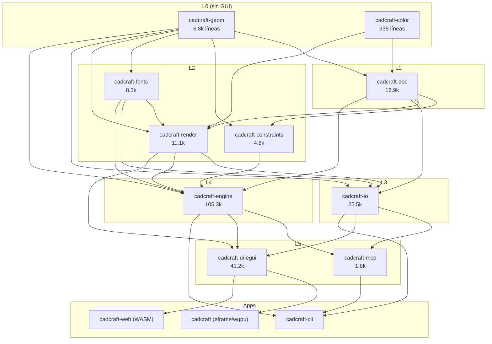
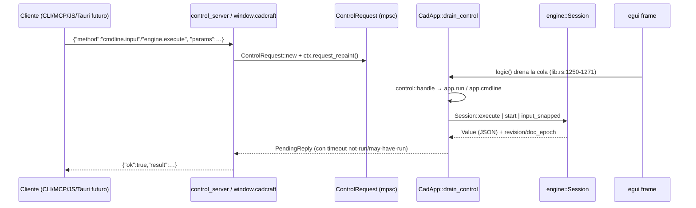

# Auditoría arquitectónica de CADCraft — Migración de GUI

**Alcance:** solo lectura. No se modificó ni creó ningún archivo, no se instalaron dependencias y no se ejecutaron `cargo test`, `clippy` ni migraciones. Los recuentos son estáticos (ocurrencias de `#[test]`, líneas y `use`), no resultados de ejecución. El único cambio presente en el checkout es preexistente: `mock_absolute_vector.html` (modificado por el usuario; no tocado).

---

## 1. Mapa general del proyecto

### Lenguajes, frameworks y build

| Elemento | Hecho comprobado |
|---|---|
| Lenguaje principal | Rust, **~324 k líneas** en 1.105 archivos `.rs` (incluye tests); edición 2024, Rust 1.95, resolver 3, versión 0.21.0 (`Cargo.toml:1-11`) |
| GUI | `egui`/`eframe` 0.37 con `wgpu`, `accesskit`, `persistence` (`Cargo.toml:79-88`, `apps/cadcraft/Cargo.toml`) |
| Ventanas/puertos | forks pinned de storytold para egui/winit e integración `craft-ui`/`craft-window` (`Cargo.toml:127-139`) |
| GPU | `egui-wgpu` + `wgpu`; shader WGSL en `crates/ui-egui/src/gpu.rs:411-498` |
| Web actual | Trunk + wasm-bindgen + eframe web runner; WebGPU con fallback WebGL2 (`apps/cadcraft-web/Trunk.toml`, `apps/cadcraft-web/src/main.rs:1-10`) |
| Sin GUI | `tiny-skia`, `lyon_tessellation`, `kurbo`, `rstar 0.13`, `craft-dxf/dwg/svg/pdf/csv/mcp/jsonrpc` de `storytold/craft-libs` a revisión fija (`Cargo.toml:15-43`) |
| TypeScript / React / Vite / Tauri | **Ausentes**. No hay `.ts`, `.tsx`, `.js`, `.jsx`, `package.json` ni `vite.config.*` escritos a mano; `tauri` y `typescript` solo aparecen como prohibición en `AGENTS.md:26` |
| entrance points | `apps/cadcraft/src/main.rs:451` (desktop), `apps/cadcraft-cli/src/main.rs` (CLI/MCP), `apps/cadcraft-web/src/main.rs:115` (WASM), fachada `CadApp` en `crates/ui-egui/src/lib.rs:290` |

### Árbol simplificado y capas



La tabla oficial de capas está en `xtask/src/layers.rs:35-53`: L0 `geom`/`color`, L1 `doc`, L2 `constraints`/`fonts`/`render`, L3 `io`, L4 `engine`, L5 `ui-egui`/`mcp`. La lista de crates considerados GUI está en `layers.rs:69-74` (`craft-ui`, `egui`, `eframe`, `egui-wgpu`, `wgpu`, `winit`, `egui_kittest`, `rfd`, `bevy*`) con `UI_MIN_LAYER = 5`: **ningún crate por debajo de L5 puede depender de ellos**. Esto ya garantiza por diseño que el motor sea portátil.

Sistemas de ejecución: `cargo xtask ci` (fmt, clippy, tests, i18n, assets, layers, wasm; `xtask/src/main.rs:15-30`), `cargo xtask parity` regenera `docs/parity-checklist.md`, `cargo xtask layers` y `assets`. Desktop: `cargo run --release -p cadcraft -- --sample --control PORT`. CLI: `cadcraft-cli info/run/convert/commands/mcp`.

**Artefacto relevante para la migración:** `mock_absolute_vector.html` es un estudio de diseño HTML/CSS/Canvas 2D de 765 líneas; su propio encabezado dice «Design study only — not application code and not a replacement for the egui front end» (`mock_absolute_vector.html:1-6`). No está conectado al motor.

---

## 2. Arquitectura del motor CAD

| Módulo | Responsabilidad | Archivos principales | Dependencias | API pública | GUI | Reutilizable |
|---|---|---|---|---|---|---|
| **geom** | Vectores, curvaturas, intersecciones, NURBS, regiones | `src/lib.rs:21-36`, `vec.rs`, `curve.rs`, `mat.rs`, `intersect.rs`, `spline.rs`, `nurbs.rs`, `region.rs`, `fillet.rs` | solo `serde` | `Vec2/Vec3`, `Mat3/Mat4`, `Line/Arc/Circle/Ellipse/Polyline/Segment`, `Bounds2`, `Spline`, `intersect_segments`, `tangent_circles` | Ninguna | Sí, directamente |
| **color** | ACI, true colour, ByLayer/ByBlock | `src/lib.rs:9-11,41-80` | solo `serde` | `Rgb`, `Color::{ByLayer,ByBlock,Index,True}`, `resolve`, `nearest_aci` | Ninguna | Sí |
| **doc** | Base de datos del dibujo, handles, COW | `src/lib.rs:101-172`, `store.rs:1-27`, `entity.rs:12-18`, `tables.rs` | geom, color, craft-dxf, serde | `Drawing`, `Entity {handle,common,kind}`, `Handle(u64)`, `Layer`, `Block`, `Layout`, `Prim`, `EntityStore` | Ninguna | Sí |
| **constraints** | Solver paramétrico propio | `src/lib.rs:39-42,507-525`, `lm.rs`, `dof.rs`, `expr.rs` | geom, doc | `solve`, `autoconstrain`, `dof`, `Expr` | Ninguna | Sí |
| **fonts** | Fuente stroke, SHX/TTF, MTEXT, BiDi | `src/lib.rs:37-44,326-459`, `mtext.rs`, `ttf.rs`, `shx.rs` | geom, harfrust, skrifa, unicode-bidi, icu_segmenter… | `shape_stroke`, `shape_line`, `TextFont`, `Shaped`, `layout_mtext` | Ninguna (salvo sistema de fuentes) | Sí, con cuidado en wasm |
| **render** | Display list + rasterizador CPU | `src/lib.rs:1-6,425-443`, `pipeline.rs:13-50`, `display.rs:72-118`, `raster.rs:9-16,79`, `linetype.rs`, `hatch.rs`, `dim.rs`, `viewports.rs` | geom, color, doc, fonts, tiny-skia, lyon; rayon fuera de wasm | `Options`, `build/build_plot/build_entities`, `DisplayList/DPrim/Kind`, `raster::render/render_png`, `dimension_geometry` | Ninguna | Sí; `DisplayList` **no deriva serde** (`display.rs:72-118`) |
| **engine** | Sesión, comandos, prompts, snap, selección, undo, unidades | `src/lib.rs:98-198`, `cmd.rs:72-90`, `session/*`, `prompt.rs:317-400`, `snap.rs`, `select.rs`, `grips.rs`, `undoctl.rs`, `units.rs` | L0-L2 + rstar + serde/json + log | `Session::{execute,start,input,cmdline,script,undo,redo,doc_mut}`, `command_specs`, `Interactive` | Ninguna en tipos | Sí, con adaptación semántica |
| **io** | DXF/DWG/SVG/SVGZ/PDF/PNG | `src/lib.rs:20-27,93-253`, `dxf_write/`, `pdf_read.rs`, `raster.rs` | doc, geom, render, fonts, craft-dxf/dwg/svg/pdf | `read`, `write`, `write_with`, `SaveOptions`, `plotter::plot`, `png` | Ninguna | Sí |

### Detalles que importan para la migración

- **Comandos.** `CommandSpec` (`crates/engine/src/cmd.rs:76-90`) contiene `id`, `label`, `menu`, `shortcut`, `aliases`, `params`, `enabled`, `run`, `undoable`, `interactive`, `transparent`. El registro `command_specs()` (`cmd.rs:182-228`) reúne ~41 familias; el checklist generado registra **449 comandos** (`docs/parity-checklist.md:7`) y hay 465 sitios `CommandSpec::new(` en el código actual. `find_command`/`resolve_alias` en `cmd.rs:230-245`.
- **Dos formas de ejecución.** JSON sin diálogos (`Session::execute`, `session/execute.rs:11-93`, con `catch_unwind` y snapshot de undo) e interactiva (`Session::start`/`input`/`feed`, `session/interactive.rs:85-206,405-538`). Esta dualidad es el contrato que ya usan CLI, MCP y el canal de control.
- **Herramientas dentro del engine, no en la GUI.** El trait `Interactive` (`prompt.rs:317-400`) y máquinas concretas como `LineM` (`cmd/draw/line_pline.rs:67-100`) guardan el progreso del comando. No existe un `Tool` global; el único `enum Tool` es local de MLINE (`cmd/draw2/mline.rs:496-526`).
- **Documento.** `Arc<Drawing>` + `Arc::make_mut` (`engine/src/lib.rs:269-275`); `EntityStore` con chunks `Arc<Vec<Arc<Entity>>>` y 64 shards (`doc/src/store.rs:1-27,99-177`). No hay `Document`/`EntityId`: son `Drawing` y `Handle(u64)`.
- **Cambios.** `DocState::is_dirty()` compara identidad de `Arc` (`doc_state.rs:84-86`); `revision` se incrementa en cada comando/undo (`session/execute.rs:87`, `doc_state.rs:89-95`) y es la señal que usa el canvas para reconstruir (`canvas.rs:93-100`). **No hay bus de eventos ni callbacks de suscripción**.
- **Undo/redo.** `Snapshot {label, doc: Arc<Drawing>, selection}` (`doc_state.rs:5-9`), pilas en `DocState`, `MAX_UNDO = 2000` (`undoctl.rs:9`), marcas y grupos en `UndoCtl` (`undoctl.rs:27-169`).
- **Snap/selección.** `osnap`, `osnap_all`, `ortho`, `polar`, `grid_snap` (`snap.rs:233-247,1175-1226`), `Session::snap_cursor` con `CursorQuery/CursorSnap` (`snap/tracking.rs:747-841`), picking `select::pick` y selection window/fence/polygon (`select.rs:415-659`). Todo con `Vec2`/`Handle`, sin tipos de pantalla.
- **Render.** `build` produce `DisplayList` en coordenadas de mundo con `DPrim::{Polyline,Tris,Mask,Point,Infinite,Image}` (`display.rs:12-28,91-118`); hay límites de seguridad `MAX_BLOCK_EXPANSION=2_000_000` y `MAX_DISPLAY_POINTS=64_000_000` (`render/src/lib.rs:139-149`). El rasterizador CPU (`raster.rs`) es la referencia silenciosa para PNG/plot/tests. No hay tipo `Camera`: la vista es `engine::View {center,height,twist}` (`engine/src/view.rs:5-14`) y la transformación pantalla es `ui-egui::canvas::Xf` (`canvas.rs:44-91`).

---

## 3. Auditoría de la GUI actual

`CadApp::draw` (`crates/ui-egui/src/lib.rs:1211-1248`) compone, en orden: título/toolbar (`chrome.rs:65-167`), menú (`menus.rs:806-830`), pestañas (`chrome.rs:170-260`), paleta Tool Sets (`palettes.rs`), `CentralPanel` con `docking::show` (`docking.rs:323-414`, basado en `craft_ui::docking`, no `egui_dock`), barra de estado (`chrome.rs:332-380`) y overlays (diálogos, cierre, autosave, GPU).

| Superficie | Implementación | Lógica CAD dentro |
|---|---|---|
| Menús | `menus.rs`: `MENUS:9`, `UI_COMMANDS:79-142` (~62 comandos solo-UI), `tree:700`, `activate:847`; menú nativo macOS `apps/cadcraft/src/native_menu.rs:13-165` | Nombres/rutas/atajos. `activate` llama a `app.start`; además consulta `find_command` para atajos (`keys.rs:189,303`) |
| Toolbar / Tool Sets | `chrome.rs`, `palettes.rs`, `blocks_palette.rs` (1.735 líneas) | Solo lanzan `app.run(id, params)` / `app.start(id)` |
| Inspector de propiedades | `engine::properties::{Description,Group,Row}` alimenta la paleta; edición en `palettes.rs` y `quick.rs` | Las filas/variaciones están en el engine; el widget es de la GUI |
| Canvas | `canvas.rs:852-1043`, `paint_canvas:1138-1289`, 15 submódulos en `canvas/`: `press`, `pick`, `grips`, `dyn_boxes`, `cursor`, `viewport`, `grid`, `cycle`… | **Aquí está la lógica de interacción**: `Xf`, `CanvasState`, `hot_grips`, `snap`, `track`, conversión a `Input` |
| Diálogos | despacho en `dialogs.rs:11-47`; capas/unidades/dsettings/hatch/array/about/commands/etc.; 45 `egui::Window::new` | Muchos leen/escriben el engine: p. ej. `dialogs.rs:51-62` lee `session.drafting_settings()` y **escribe `session.settings` directamente**, sin comando registrado |
| Layout persistente | `UiState` (`lib.rs:98-148`, serde) + `docking::Workspace` (`docking.rs:79-114`) + `App::save` (`main.rs:170-174`) | Solo preferencias de UI |
| Entrada | `raw_input_hook` (`lib.rs:1064-1108`), `cmdline::capture_tab` (`cmdline.rs:67-85`), `builtin_shortcuts`/`shortcuts` (`menus.rs:934-1049`), eventos de puntero en `canvas.rs:874-883,936,1107-1136` | Traduce a `Input::{Point,Keyword,Enter}`, `input_snapped`, `idle_click` |
| Ventanas flotantes | `craft-ui` `native-windows`, `os_window.rs`, `capture.rs`, `closing.rs`, `save_loss.rs`, `autosave.rs` | Prompt de cierre/guardado: lógica de aplicación, no CAD |

**Qué es puramente visual y qué no.** Son visuales: `theme.rs`, `icons.rs`, `chrome.rs`, `docking.rs`, `viewcube.rs`, `animation.rs`, `i18n.rs` (presentación), `gpu.rs` (pegado a egui), `capture.rs`. Contienen lógica CAD o de aplicación: `canvas/*`, `cmdline.rs`, `menus.rs`, `keys.rs`, `dialogs.rs`, `palettes.rs`, `blocks_palette.rs`, `options.rs`, `closing.rs`, `save_loss.rs`.

**Debe trasladarse al nuevo frontend** (React): chrome, menús, toolbars, toolsets, paletas, inspector, diálogos, layout, temas, atajos visuales, accesibilidad. **Debe permanecer en Rust**: registro de comandos, prompts, snap, selección, undo, unidades, COW del documento, render a `DisplayList`, codecs de archivo, solver.

---

## 4. Acoplamiento entre egui y el motor

### Resultado de la búsqueda (hecho comprobado)

| Crate | Archivos que mencionan `egui/eframe/egui-wgpu/wgpu/winit/epaint` |
|---|---:|
| `geom`, `color`, `doc`, `fonts`, `render`, `constraints`, `io`, `mcp` | **0** |
| `engine` | **1**, solo comentarios en `cmd/constraints/tests.rs:300,338` que citan `ui-egui/src/parametric.rs`; **0** como identificador |
| `ui-egui` | 83 de 85 archivos |
| `apps/cadcraft` | 13 de 22 |
| `apps/cadcraft-web` | 3 de 6 |

`Cargo.toml` de `engine` (`crates/engine/Cargo.toml:11-30`) declara solo L0-L2, `craft-*`, serde/json, log, `rstar` y `libc` en Unix. `xtask/src/layers.rs:69-74` prohíbe la dependencia inversa por CI.

### Ejemplos concretos de acoplamiento

1. **Despacho de comandos** — `crates/ui-egui/src/lib.rs:611-631`:
   ```rust
   pub fn run(&mut self, id: &str, params: Value) -> Result<Value, String> {
       if let Some(r) = menus::run_ui_command(self, id, &params) { return r; }
       self.sync_bars();
       let r = self.session.execute(id, &params).map_err(|e| e.to_string());
       self.sync_bars();
       // ... eco del mensaje en session.log
   }
   ```
   `start` (`:634-649`) y `cmdline_or` (`:660+`) hacen lo mismo para la vía interactiva.

2. **Ratón → engine** — `canvas.rs:980-983`:
   ```rust
   self.session.input_snapped(hit)
   self.session.input(Input::Point(p))
   ```
   y `press_at` (`canvas.rs:1107-1136`) re-aplica `Input::Keyword`, snap e `idle_click` en el *press*, no en el *release*. La semántica de clic (tolerancia 6 pt, retardo 0,25 s) vive en `canvas/press.rs:20-100`, es decir **en la GUI**.

3. **GPU dentro de egui** — `gpu.rs:688` `install(rs: &egui_wgpu::RenderState, …)`, `CanvasCallback: egui_wgpu::CallbackTrait` (`gpu.rs:700-783`) y `paint(&mut wgpu::RenderPass)`. El shader WGSL (`gpu.rs:411-498`) es wgpu puro y se valida también como GLSL ES 3.0 con naga (`gpu.rs:945-961`), pero el pegado es egui.

4. **Estado híbrido en el engine sin ser egui** — `Session` (`lib.rs:98-198`) expone `cursor`, `cursor_deferred`, `ctrl_down`, `viewport_px`, `bars_shown`/`bars_request` (`:190-193`), `hatch_picks`, `wblock_picks`, `pending_window`: campos que la GUI rellena y el engine consume. Es acoplamiento **semántico**, no de tipos.

5. **Excepción a la regla de comandos** — `dialogs.rs:51-62` escribe `app.session.settings` desde el widget de Drafting Settings; `AGENTS.md:14` exige que los paneles cambien el estado solo mediante comandos registrados. Es un punto a corregir antes de duplicar la paleta en React.

### Clasificación

| Clase | Módulos | Criterio |
|---|---|---|
| **A. Independientes de la GUI** | `geom`, `color`, `doc`, `constraints`, `fonts`, `render`, `io`, `engine` (a nivel de tipos), `mcp` | Cero imports de toolkit; compilan en wasm (con rayon desactivado) |
| **B. Parcialmente acoplados** | `engine::Session` (estado orientado a UI), `apps/cadcraft/src/control_server.rs` (usa `egui::Context` solo para `request_repaint`), `apps/cadcraft-web/src/api.rs` (puente JS) | Sin tipos de widgets, pero dependen de un ciclo de frame |
| **C. Fuertemente acoplados** | `ui-egui::CadApp`, `CanvasState`, `canvas/*`, `gpu.rs`, `menus.rs`, `cmdline.rs`, `dialogs.rs`, `palettes.rs`; `apps/cadcraft::App` (`impl eframe::App`, `main.rs:103-178`); `apps/cadcraft-web::Shell` (`main.rs:37-85`) | No se pueden usar sin egui/eframe |
| **D. Exclusivamente visuales** | `theme.rs`, `icons.rs`, `chrome.rs`, `docking.rs`, `viewcube.rs`, `animation.rs`, `capture.rs`, `os_window.rs`, `switch.rs`, `i18n.rs` (capa de presentación) | Se pueden reemplazar 1:1 por React/CSS |

---

## 5. Comunicación y estado



- **Comandos:** `control::handle` (`control.rs:310-565`) despacha `engine.execute` → `app.run` (`:323-328`), `cmdline.input` → `app.cmdline` (`:334-347`), `ui.menu.invoke` → `menus::activate` (`:329-333`), `ui.pointer` → `Input`/`idle_click` (`:393-412`). La lista canónica de 27 métodos está en `control.rs:214-242` y se contrasta con la documentación en `tests/it/control_methods.rs:23-60`.
- **Transporte:** TCP loopback JSON-lines, **no HTTP**, con token de 256 bits por sesión (`control_server.rs:58-82`; `crates/mcp/src/control_token.rs:14-24,61-76`), 16 conexiones, 64 peticiones en cola, 256 MiB/línea, timeout 60 s (`control_server.rs:20-54`). La semántica `not-run`/`may-have-run` está en `control.rs:73-89`.
- **Notificación de cambios:** no hay eventos. Observer implícito = `DocState::revision`, `Session::doc_epoch`, `DocState::is_dirty()` y `session.log`. El canvas compara claves `(uid, revision, tessellation band, …)` en `canvas.rs:93-100`.
- **Propiedades/selección:** `Session::doc_mut()` usa COW; `DocState::selection: Vec<Handle>`; `Session::set_selection` y `selection()`. La GUI lee el mismo `&mut Session`, sin capa de sincronización.
- **Actualización del canvas:** `request_repaint()` y reconstrucción de `DisplayList` en hilo de trabajo (`canvas/rebuild.rs:86-103`); fallback CPU/GPU en `canvas.rs:453-457`.
- **Estado global:** `CadApp` (`lib.rs:290-395`) + `Session` + `UiState`; persistencia en `app.ron` vía `App::save` (`main.rs:170-174`).
- **Sincronía/asincronía:** las peticiones de control son síncronas desde el cliente y se ejecutan en el hilo de frame; asíncronos son los diálogos de archivo (`Services::start_pick`, `PendingPick` en `lib.rs:277-288,553-573`), la apertura en segundo plano (`opening.rs`), el rebuild del display list y el autosave.
- **Precedente decisivo para TS:** `apps/cadcraft-web/src/api.rs:19-41` ya instala `window.cadcraft` mediante `craft_web_api::PageApi`; cada llamada JS se convierte en un `ControlRequest` y se encola en el mismo `CadApp` (`main.rs:171-172`). Es exactamente el adaptador que Tauri IPC necesitaría, ya implementado para otro transporte.

---

## 6. Renderizado y alternativas

| Alternativa | Código reutilizable | Cambios necesarios | Nuevo desarrollo | Dependencias | Riesgo de rendimiento | Integración |
|---|---|---|---|---|---|---|
| **A. Conservar Rust/wgpu** | WGSL `gpu.rs:411-498`, `build_mesh` y validación naga→GLSL (`gpu.rs:945-961`), `DisplayList` | Extraer `CanvasCallback` del `egui_wgpu::CallbackTrait`; exponer surface nativa propia | Composición webview↔surface, stencil de viewports recortados, sincronización de frames | wgpu, naga, Tauri window handle | Bajo si se comparte device; alto si hay dos surfaces | **Alta** |
| **B. Renderer WebGL/WebGPU nuevo** | `cadcraft-render::build` y `DisplayList` como fuente de verdad; `raster.rs` como oráculo | Serializar `DPrim`/`Kind` (hoy sin serde, `display.rs:72-118`) o generar buffers en Rust/WASM | Vertex/index buffers, culling, text/hatch, picking en TS o WASM | regl/webgpu o wgpu en WASM; rAF | Medio: 64 M puntos tope,Transferencia JS↔WASM | Media |
| **C. Motor en WASM** | Casi todo L0-L4; `render` ya tiene ramas `cfg(wasm32)` sin rayon (`pipeline.rs:1-5`) | Adaptar `Services` (sin sistema de archivos), `atomic_write`/`capped_read` (nativos), `rfd` | Empaquetado, hilos/SharedArrayBuffer, estrategia de fuentes (`fonts/build.rs` incrusta subconjunto) | wasm-bindgen, Trunk, craft-web-api | Medio-alto en dibujos grandes | Media-baja (ya existe `apps/cadcraft-web`) |
| **D. Rust nativo + Tauri 2** | `Session`, `engine`, `io`, `render`, el protocolo de control y `window.cadcraft` | Separar la parte UI-free de `control::handle` y mapearla a `invoke`/eventos | Adaptador IPC tipado, canvas nativo o web, migración de diálogos | Tauri 2, React, TS, Vite | Depende de A o B | **Media**, pero ver nota normativa abajo |

**Hechos vs hipótesis.** Hecho: el shader es wgpu estándar y se valida en GLSL ES 3.0; `render` compila en wasm; la WASM app ya corre con WebGPU/WebGL2 (`apps/cadcraft-web/src/main.rs:217-223`). Hipótesis (no verificada): que un surface wgpu nativo pueda composicionarse sin fricción con el webview de Tauri; que un renderer TS alcance paridad de linetypes/hatches/texto; que el coste de serializar `DisplayList` sea aceptable. Ninguno fue medido.

**Nota normativa (no técnica):** `AGENTS.md:11` exige «Rust only: no handwritten JavaScript or TypeScript, Tauri, Electron or webview»; `:9` obliga a reutilizar `craft-libs`; `:22-23` prohíbe nombres de terceros y copiar código/activos ajenos. La arquitectura objetivo requiere una RFC aprobada antes de escribir código; la referencia visual a Vectorworks 11.5 solo puede ser una especificación de comportamiento, nunca código ni activos.

---

## 7. Funcionalidades existentes

Estados: **Completa** = implementada y con tests en código; **Parcial** = implementada con huecos documentados o verificables; **Experimental** = presente pero no consolidada; **No implementada** = ausente en código; **No verificable** = no determinado con la inspección.

| Funcionalidad | Implementación | Módulo | Dependencia de egui | Reutilizable |
|---|---|---|---|---|
| Dibujo 2D (LINE, PLINE, CIRCLE, ARC, SPLINE, ELLIPSE…) | Completa | `engine/src/cmd/draw*.rs`, `curves.rs` | No | Sí |
| Edición (ERASE, COPY, MOVE, TRIM, EXTEND, OFFSET, FILLET…) | Completa | `engine/src/cmd/modify*.rs`, `trimextend.rs`, `geom/fillet.rs` | No | Sí |
| Transformaciones / grips / ARRAY en vivo | Parcial (hot grips y menús por grip; faltan multifunción en cotas/texto conforme `docs/ui-parity.md`) | `engine/src/grips.rs`, `array_live.rs`, `ui-egui/src/canvas/grips.rs` | Parcial (visualización) | Motor sí, GUI no |
| Selección (punto, ventana, cruzamiento, fence, polígono, grupo, cycling) | Completa; **lasso no implementada** | `engine/src/select.rs:415-659`, `cmd/selecttools.rs` | No (motor) | Sí |
| Snap (END/MID/CEN/INT/PER/TAN/PAR/EXT/APP, tracking, ortho, polar, cuadrícula) | Completa; hay categorías aún ausentes según `docs/ui-parity.md` | `engine/src/snap.rs`, `snap/{iso,tracking,curves,viewport}.rs`, `pointmod.rs` | No | Sí |
| Capas | Completa | `doc/src/tables.rs:12`, `engine/src/cmd/layer.rs`, `ui-egui/src/layers.rs` | Parcial (paleta) | Motor sí |
| Clases DXF | No verificable como entidad de primera clase; `doc/src/foreign.rs` conserva registros no modelados | `doc/src/foreign.rs` | No | Parcial |
| Grupos / bloques / xrefs | Parcial (bloques y xrefs implementados; fidelity de xrefs parcial según `docs/gaps.md`) | `engine/src/cmd/blocks/`, `doc/src/dynblock*`, `io` | No | Sí |
| Propiedades de objeto y paleta | Parcial | `engine/src/properties.rs`, `ui-egui/src/palettes.rs` | Sí (widget) | Datos sí, UI no |
| Historial (UNDO/REDO, marcas, grupos, UP) | Completa, tope 2000 | `engine/src/undoctl.rs:9`, `session/execute.rs:104-131`, `doc_state.rs` | No | Sí |
| Unidades y formatos de entrada | Completa | `engine/src/units.rs:11-441`, `prompt.rs:499-513` | No | Sí |
| Navegación 2D / zoom / pan / VIEW / VPORTS | Completa | `engine/src/cmd/view.rs`, `engine/src/view.rs`, `ui-egui/src/canvas/viewport.rs` | Parcial (Xf) | Motor sí |
| Vistas 3D / órbita / cámara | No implementada (ítems listados como no cubiertos en `docs/parity-checklist.md`) | — | — | — |
| Cotas y asociatividad | Completa/Parcial (geometría y estilos; algunos modos no cubiertos) | `render/src/dim*.rs`, `engine/src/assoc.rs`, `cmd/annotate*` | No | Sí |
| Restricciones paramétricas | Completa (solver) / Parcial (UI de Parameters Manager) | `constraints/src/*`, `engine/src/cmd/constraints` | No | Sí |
| AutoLISP | Completa (evaluador y builtins), cobertura No verificable frente a la referencia | `engine/src/lisp/*` | No | Sí |
| Import DXF/DWG/SVG/SVGZ, import PDF | Completa/Parcial (DWG con pérdidas documentadas en `docs/gaps.md:16`) | `crates/io`, `engine/src/cmd/file.rs`, `exchange.rs` | No | Sí |
| Export DXF/DWG/DWT/SVG/PNG/PDF | Completa; planes/plot styles Parcial | `io/src/lib.rs:119-253`, `plotter.rs` | No | Sí |
| Guardar/abrir, autosave, recuperación | Completa en nativo; **web sin sistema de archivos** (`no_file_system: true`) | `engine/src/cmd/file.rs`, `autosave.rs`, `apps/cadcraft-web/src/main.rs:107-113` | No | Sí (adaptar host) |
| Dynamic Input, grips dimensionales, command line | Parcial (~48% UI/UX estimado, `docs/ui-parity.md`) | `ui-egui/src/dyninput.rs`, `grip_dyn.rs`, `cmdline.rs` | Sí | Parcial |
| Workspaces, barra de navegación, menús de grip hover | No implementada (`docs/ui-parity.md`) | — | — | — |
| Espacio ratón 3D / menú nativo macOS /ventanas flotantes nativas | Completa solo desktop | `apps/cadcraft/src/spacemouse.rs`, `native_menu.rs`, `craft-window` | Sí | No (specífico de host) |

Inventario global: 449 comandos registrados y **298/491 (61%) ítems de menú cubiertos** (`docs/parity-checklist.md:7`); la fidelidad UI/UX es una estimación documental de ~48% no re-medida (`docs/ui-parity.md`).

---

## 8. Tests y estabilidad

Recuento estático de `#[test]` (no ejecutados):

| Crate | Tests | Foco |
|---|---:|---|
| engine | 2.161 (610 en `src`, 1.551 en `tests`) | prompts, comandos, undo, bloques, snap/tracking, LISP, inputs hostiles |
| io | 1.117 | roundtrip DXF/DWG, formatos, proxy/xdata |
| ui-egui | 760 (388 en `src`) | kittest, accesibilidad, canvas, diálogos, control |
| render | 237 | display list, cotas, hatch, viewports, PNG parity |
| fonts / doc / geom / constraints / mcp | 155 / 136 / 120 / 54 / 40 | texto, COW/handles, geometría, solver, protocolo |
| apps (cadcraft/cli/web) + xtask | 129 / 88 / 7 / 26 | args, MCP, workspace, capas |

Hay un binario de integración `tests/it/main.rs` por crate relevante (engine, io, doc, render, ui-egui, mcp, CLI). Tests de UI con `egui_kittest`: `canvas/draw.rs:474`, `mtext_editor.rs:642`, `palettes.rs:1689`, `palettes/quickcalc.rs`, `palettes/layer_menu_tests.rs:5`; aserciones sobre `accesskit::Role` yárbol de accesibilidad en `mtext_editor.rs:623-753`, `palettes/quickcalc.rs:542`. Capturas con `capture/tests.rs:66-234`. Validación del shader WGSL/GLSL en `gpu.rs:945-961`. Contrato del protocolo verificado en `ui-egui/tests/it/control_methods.rs:23-60`. **No hay porcentaje de cobertura de código en el repo**; hay configuración SonarCloud, pero sin herramienta local de cobertura.

**Sin pruebas evidentes / riesgo:** equivalencia de píxeles entre el renderer GPU (egui) y un renderer web; equivalencia de secuencias de eventos de ratón/teclado; paridad entre `Engine.commands` y la futura paleta React; rendimiento de `build` con dibujos grandes; accesibilidad del nuevo frontend frente al árbol AccessKit actual.

**Pruebas a establecer antes de migrar** (behavioural, no de implementación):

1. **Golden de comandos:** snapshot de `engine.commands` (id, menú, alias, enabled, params) y diff automático en CI.
2. **Golden de documento:** roundtrip de corpus externo (`CADCRAFT_CORPUS_DIR`, `xtask/src/main.rs:231-267`) comparando `Drawing`/handles y PNG de `raster::render`.
3. **Golden de interacción:** grabar secuencias `ui.pointer`/`ui.key`/`cmdline.input` y sus resultados de `drawing.inspect` + `revision`; replayarlas en el nuevo frontend.
4. **Paridad de render:** comparar PNG del canvas GPU actual frente al nuevo canvas para una lista fija de vistas (linetypes, hatches, TTF/SHX, viewports, transparencias).
5. **Undo/redo invariante:** mismo número de pasos y mismo `Drawing` tras secuencias de comandos, tanto por JSON como por prompts.
6. **Accesibilidad:** mismo conjunto de roles/nombres/estados que el árbol egui para cada diálogo migrado.
7. **Regresión de protocolo:** misma semántica de `not-run`/`may-have-run` y de los 27 métodos en el adaptador Tauri.

---

## 9. Posibilidad de una nueva GUI (React + Vite + Tauri 2 + Rust)

| # | Respuesta |
|---|---|
| 1 | **Técnicamente viable**, porque ya existe un límite JSON probado (`control.rs:214-242`) y un adaptador JS funcionando (`apps/cadcraft-web/src/api.rs`). **Pero no está permitido por las reglas actuales** del repositorio (`AGENTS.md:11,26`): hace falta RFC antes de empezar. |
| 2 | Sin cambios: `geom`, `color`, `doc`, `fonts`, `constraints`, `render`, `io`, los 449 comandos, prompts, snap, selección, undo, unidades, `Session`, codecs, `raster`, el protocolo de control y el MCP. |
| 3 | Desacoplar: `control::handle` (hoy exige `&mut CadApp` + `&egui::Context`), `CadApp::run/start/cmdline`, `Services` (diálogos nativos), dependencias `IoHooks` (`main.rs:181-202`), y los escritos directos a `session.settings` desde diálogos (`dialogs.rs:51-62`). |
| 4 | Reemplazar: `ui-egui` completo (chrome, menús, paletas, canvas, GPU, docking, temas, iconos) y la capa `eframe` de `apps/cadcraft`. `apps/cadcraft-web` quedaría obsoleto si se unifica el frontend. |
| 5 | Pérdidas probables si no se replican: semántica press-first y drag-delay (`canvas/press.rs:20-100`), grips dinámicos, AccessKit, menú nativo macOS, paneles en ventanas OS, sheets, HID SpaceMouse, stencil para viewports recortados, capturas/screenshots y persistencia de workspace. |
| 6 | Problemas anticipados: dos modelos de estado (React vs `Session`) sin fuente única; duplicación de `UiState`; sin eventos push (hay que sondear `revision`); serializar `DisplayList` sin serde; paridad tipográfica (stroke/SHX/TTF); reglas de licencias/nombres del proyecto. |
| 7 | **Mayor dificultad técnica: el canvas**, no los comandos. Reunir input semántico (snap, tracking, grips, direct distance), cámara `Xf`/`View` y paridad de render GPU/CPU en un nuevo surface. |

---

## 10. Matriz de reutilización

| Módulo | Conservar | Adaptar | Reemplazar | Riesgo |
|---|---|---|---|---|
| `geom`, `color` | ✔ total | — | — | Muy bajo |
| `doc` (`Drawing`, `Handle`, `EntityStore`) | ✔ total | — | — | Bajo |
| `constraints` | ✔ total | — | — | Bajo |
| `fonts` | ✔ total | integración de fuentes en host/web | — | Medio (fuentes del sistema) |
| `render` (pipeline, `DisplayList`, `raster`) | ✔ total | serialización de primitivas si el renderer sale de Rust | GPU path de `ui-egui` | Medio-alto |
| `io` | ✔ total | hooks de archivos del host (Tauri FS) | — | Medio (confinamiento de rutas) |
| `engine` (comandos, prompts, snap, undo, unidades) | ✔ total | separar campos UI-orientados;对话框→comandos | — | Medio |
| `mcp` / protocolo de control | ✔ total | transporte Tauri IPC en lugar de TCP | — | Bajo-medio |
| `ui-egui::menus` | metadatos (`UI_COMMANDS`, `tree`) | despacho a React | `egui::menu`, native menu | Medio |
| `ui-egui::canvas` | conceptos (`Xf`, `Press`, `CanvasState`) | lógica de input al nuevo canvas | pintado egui/GPU | **Alto** |
| `ui-egui::gpu` | WGSL y validación naga | surface/pipeline | `CallbackTrait` | **Alto** |
| `ui-egui::{theme,icons,chrome,docking,palettes,dialogs}` | textos/grupos/IDs | — | ✔ por React/CSS | Medio |
| `apps/cadcraft` (`main.rs`, workspace, native_menu, HID, `control_server`) | `install_io`, lógica de arranque | servicios del host | `impl eframe::App`, servidor TCP | Medio-alto |
| `apps/cadcraft-web` | `window.cadcraft` como referencia de API | — | Shell eframe | Medio |
| `mock_absolute_vector.html` | estudio visual | convertir a componentes React | Canvas 2D de juguete | No es código de producto |

---

## 11. Plan de migración recomendado (incremental)

0. **Congelar基线.** Ejecutar la suite actual y guardar los golden de §8 antes de tocar nada. (En esta auditoría no se ejecutó.)
1. **Extraer una API de aplicación UI-free.** Dividir `control::handle` en una parte que solo necesita `&mut Session` + `UiState` (`cmdline.*`, `engine.*`, `drawing.inspect`, `app.open/save`) y otra que necesita `egui::Context` (`ui.click`, `ui.elements`, `ui.screenshot`). Meter la primera en un crate L5 nuevo o en `engine`, sin cambiar los nombres de métodos.
2. **Adaptador IPC.** Implementar el mismo contrato JSON sobre Tauri `invoke`/eventos, reutilizando la semántica de `ControlRequest`/`PendingReply`. Mantener el canal TCP existente en paralelo para comparar respuestas.
3. **Pruebas de paridad de API.** Enviar las mismas secuencias a ambos transportes y exigir `drawing.inspect`, `engine.commands` y `revision` idénticos.
4. **Shell React sin canvas.** Chrome, menús, toolsets, paletas e inspector leyendo `engine.commands`/`drawing.inspect` y enviando `engine.execute`/`cmdline.input`. El canvas sigue siendo egui detrás de un placeholder: la GUI convive, no se reescribe el motor.
5. **Canvas.** Primero reutilizar `DisplayList` → `raster` para golden visual; después elegir surface: (A) wgpu nativo compartido o (B) WebGL/WebGPU consumiendo primitivas serializadas. Portar `Xf` y `Press` como lógica pura, verificada con los tests de replay.
6. **Herramientas y diálogos.** Migrar por familias, cada una con su test de replay: capas → propiedades → cotas/hatch → bloques/xrefs → opciones. Convertir los escritos directos a `session.settings` en comandos registrados.
7. **Accesibilidad y host.** Replicar roles/nombres del árbol AccessKit, menú nativo/HID/sheets o documentar su ausencia explícita en CLI y GUI (regla `AGENTS.md:15`).
8. **Validación y retirada.** Comparar rendimiento y píxeles; solo entonces eliminar `ui-egui`, `eframe`, el servidor TCP y `apps/cadcraft-web`.

No hay justificación técnica para reescribir geometría, documento, comandos, snap, undo, render a display list ni codecs: todos son GUI-free y están cubiertos por tests.

---

## 12. Conclusión ejecutiva

1. **Reutilización estimada: ~70–80% del código Rust.** Cálculo heurístico por líneas de `src`: fuera de `ui-egui` (41,2 k) y del shell de escritorio (6,2 k) quedan ~183 k de ~231 k líneas (~79%). No es una medida de funcionalidad ni de cobertura: parte del engine tiene estado orientado a UI y `DisplayList` no es serializable tal cual.
2. **Realmente independientes de egui:** `geom`, `color`, `doc`, `fonts`, `constraints`, `render`, `io`, `mcp` y el engine a nivel de tipos. La regla `xtask/src/layers.rs:69-74` lo garantiza y la búsqueda de imports lo confirma (1 mención en engine, solo un comentario).
3. **Mayor obstáculo:** el canvas — input press-first/grips/snap + cámara + paridad GPU/CPU. Segundo obstáculo: la ausencia de eventos push y de serde en `DisplayList`.
4. **¿Recomendable React + Tauri?** Técnicamente sí, y el precedente `window.cadcraft` demuestra que el puente es corto. **Pero el repositorio lo prohíbe explícitamente** (`AGENTS.md:11,26`); recomiendo primero aprobar una RFC y un cambio de norma, no empezar a codificar.
5. **¿wgpu o renderer web?** Conservaría `cadcraft-render` y el pipeline a `DisplayList` como fuente de verdad. En desktop, intentaría extraer el shader WGSL existente antes que escribir un renderer nuevo; en web, añadiría WebGL2/WebGPU solo si las mediciones de paridad/rendimiento lo exigen. No取下 el rasterizador CPU: es el oráculo de pruebas.
6. **Primer cambio técnico:** separar `control::handle` en una capa UI-free (`Session` + JSON) y una capa egui, con un test que demuestre que ambos caminos producen el mismo resultado. Es el punto de inserción natural para Tauri IPC.
7. **No tocar en las primeras etapas:** `geom`, `doc::store`/handles, `engine::cmd`/`prompt`/`snap`/`undoctl`/`units`, `render::pipeline` y `DisplayList`, `io` y sus hooks, `constraints::solve`, ni los nombres del protocolo de control. Tampoco el estudio `mock_absolute_vector.html` ni ningún archivo del usuario.
